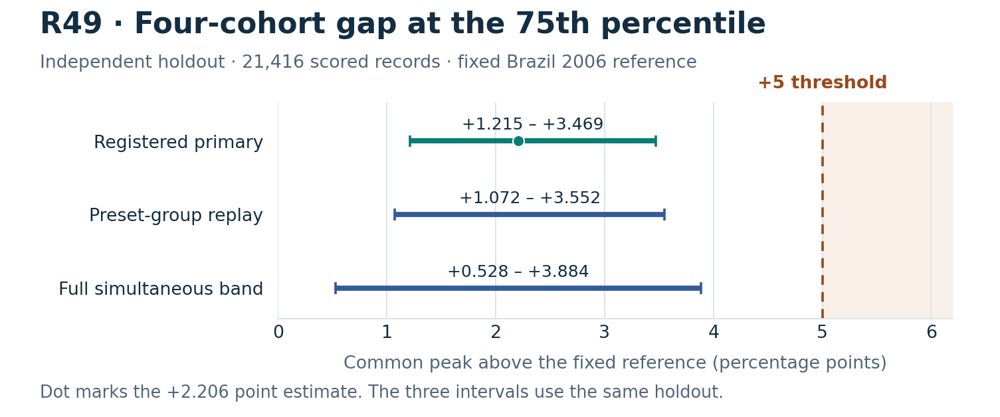
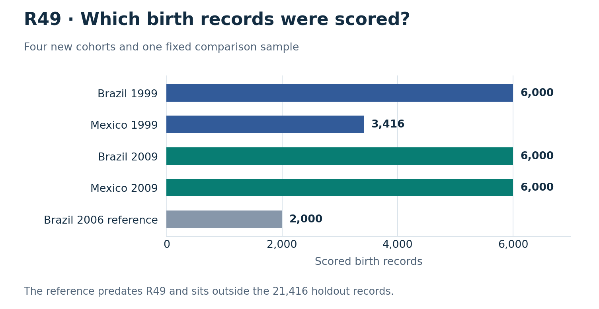
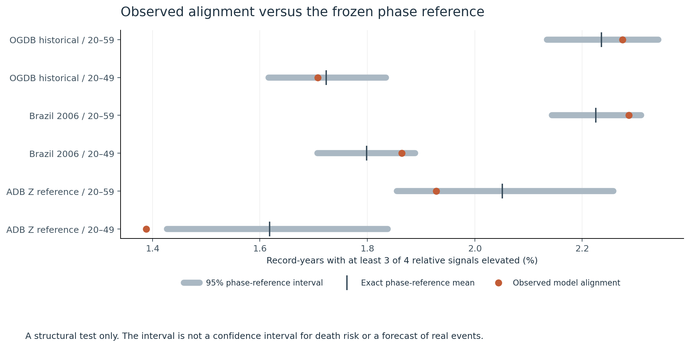

# Open Birth Chart Study

[简体中文](README.zh.md) · [Research program](docs/RESEARCH_PROGRAM.md) · [Constitution](CONSTITUTION.md) · [Research status](RESEARCH_STATUS.md) · [Reproduction](#reproduce-and-review)

Can the claim of a generational “break” in birth charts be turned into a test another researcher can repeat? We use documented birth records, four versioned calculation methods and prespecified comparisons to test whether modeled gaps concentrate at common ages or in common calendar periods.

**Current finding.** In R49, an independent holdout of **21,416 birth records** from four Brazilian and Mexican source frames excluded a common gap of **+5 percentage points** at the 75th-percentile threshold. The estimated common peak was **+2.206 points**, with a primary interval of **+1.215 to +3.469**. Transfer to East Asia and other populations remains unresolved. [R49 evidence](R49.md) · [Latest external source search](R51.md)

## What the study measures

At each completed age from 20 to 59, four specified engines assign annual scores. For the R49 test, a year is high when at least three of the four scores reach their own 75th-percentile cutoffs, calibrated by age band against a fixed sample from Brazil 2006. A ten-year gap has zero such years. For each record, subtract its mean gap rate over the 31 possible window starts, then compare that centered measure with the reference at the same age.

The four-cohort common peak is the largest, over window starts, of the smallest of the four cohort effects at each start. This asks whether **all four** show a shared concentration. A ten-year gap of some kind was already present for **99.95%** of the reference records in the R45 analysis. The concentration at a shared window is the quantity of interest. The four systems use some of the same calendars and astronomy, so their scores can be dependent. [Definition and reference design](rounds/r45/REGISTRATION.zh.md) · [R49 primary specification](rounds/r49/REGISTRATION.zh.md)

## What the latest independent sample shows



| Method applied to the R49 holdout | Interval (percentage points) | Decision for +5 |
| --- | ---: | --- |
| Registered primary comparison, adjusted across four groups | +1.215 to +3.469 | Excluded in these source frames |
| Preset-group method replayed from R46 | +1.072 to +3.552 | Excluded |
| 95% simultaneous band across groups and starting ages | +0.528 to +3.884 | Excluded |

The **34–43** window gave the estimated common peak. The intervals allow smaller common effects. They answer one question about the tested frames and calculation rules. The three rows above are methods applied to the same new sample. [Machine-readable results](rounds/r49/results.json) · [Independent calculation review](rounds/r49/review.json)

**Why did R46 give different judgments?** Its upper bounds, **+5.223** and **+4.685**, came from Brazil 2009 and Mexico 2009, respectively, at the same age-34 start. The preset-group approach used one named group. The simultaneous-band approach allowed all four groups to constrain the shared effect, using a different adjustment. R49 preregistered its group adjustment and replayed both approaches on new records. All three upper bounds were below +5. [Age-by-age comparison figure](rounds/r49/upper_bounds.png) · [R46 discrepancy analysis](rounds/r49/R46_DIFFERENCE.zh.md)

## Which records support the result



| Birth cohort | Scored in holdout | Remaining eligible source frame | Interpretation |
| --- | ---: | ---: | --- |
| Brazil 1999 | 6,000 | 43,348 | Recorded-minute source frame concentrated in Alagoas. |
| Mexico 1999 | 3,416 | 3,416 | Complete eligible set of 1999 births identified in the 2013–2016 late-registration files. |
| Brazil 2009 | 6,000 | 2,745,932 | Stratified new sample from the eligible SINASC remainder after prior records were excluded. |
| Mexico 2009 | 6,000 | 1,637,435 | Stratified new sample of actual 2009 births reconstructed from the 2009–2010 files, after exclusions. |
| Brazil 2006 reference | 2,000 | Fixed comparison | The original reference is separate from the 21,416 holdout records. |

The usable frame depends on recorded date and clock, recorded sex, occurrence location, and recoverable source metadata. Weighted inferences apply to that frame. Physical source keys were checked against earlier project samples and between the four groups. Cross-archive person identities could not be established. Documented municipal or locality coordinates can approximate birth sites. [Sample seals](rounds/r49/seals) · [Source reconstruction review](rounds/r49/source_review.json) · [Data licences and provenance](data_expansion/DATA_LICENSES.md)

## How the evidence developed

| Study | Result and scope |
| --- | --- |
| **R8 · Structural alignment** | Scored **3,729 source records** from Brazil 2006, the Open Gauquelin Database and the Astro-Databank free Z export. None of six planned alignment comparisons rejected the specified independent-phase reference after Holm correction. The smallest adjusted p-value was **0.183**. |
| **R10 · Independent reconstruction** | Recomputed four-system scores for **12,000 records** across six cohorts. Inputs for both Mexican cohorts matched their original digests. The two original Mexico sampling notes remain unavailable. Sampling metadata in R10 are documented reconstructions from official archives. |
| **R45–R46 · Where a large gap could still be plausible** | At P80, R45's same-age and same-calendar upper bounds were **+3.93** and **+3.59** points. R46's 2009 whole-hour comparison excluded +5 and its P75 methods disagreed. R49 tested that remaining P75 question on independent records. |
| **R48 · Literal period continuity** | Checked **6,766** birth records. The specified Bazi method and both tested Ziwei starting-palace rules continuously covered the adult ages examined. The original public wording and common decision rule of the circulating claim remain unverified. |
| **R47 and R50 · Transfer to other archives** | Official Japanese date-hour totals for **148,030** births allowed feasible assignments on both sides of +5 in R47's P80 panels. R50 found no qualifying Japanese or US route for the fixed-age P75 replication and verified a way to run it inside an authorized archive. |
| **R51 · Other East Asian routes** | The leading paths are Hong Kong HA's 2009 cohort and the 1999 or 2009 archives of Zhejiang custodians. Historical minute-level research fields and study-specific approval remain to be verified. R51 scored no new external records. |



The R8 chart uses within-record P80 ranks and a within-age-band phase-rotation reference. R45 and R49 use a fixed cross-cohort reference and ask where gaps concentrate. Use each chart with its study definition. [R8 original report and plots](https://github.com/CPTM511/open-birth-chart-study/blob/210bb7bdab85a9f3672f19241e9ef66eb22021a2/README.md) · [R10](R10.md) · [R45](R45.md) · [R46](R46.md) · [R48](R48.md) · [R47](R47.md) · [R50](R50.md)

R8's paired ±30-minute perturbations changed the three-of-four classifications in **2.35–3.13%** of evaluated record-years across the fixed subsets. The corresponding Western-system flags changed in **23.93–24.98%**. These measurements describe sensitivity of specific classifications. R46 later tested a whole-hour input policy directly for two 2009 cohorts. [R8 clock sensitivity figure](figures/04_clock_sensitivity.png) · [R46 follow-up](R46.md)

## The four calculation methods

| System | Structural signal | Important boundary |
| --- | --- | --- |
| Bazi | Branch clashes between natal pillars and the annual and active ten-year branches. | Full strength, pattern priority, useful-element and rescue adjudication are incomplete. |
| Ziwei Doushu | Annual and decadal Hua Ji placements in the defined life and health palaces. | Starting-period conventions can change palace placement. Mixed configurations need explicit rules. |
| Qizheng Siyu | Selected natal, transit, palace and mansion contacts under documented period rules. | The lunar apogee and additional points use specified modern calculations. Classical limit variants require separate validation. |
| Western astrology | A weighted geometric hard-contact index from transits, progressed planets and progressed axes. | The score represents the specified geometry and sampling schedule. Predictive performance requires an outcome study. |

The project records versioned parameters, clock conversion, scope and known gaps. These thresholds summarize model outputs. Claims about real events, individual predictions or AI-driven social outcomes each require their own data and design. [Implementation inventory](docs/four_system_readiness.md) · [Bazi and Ziwei](docs/bazi_ziwei_methods.md) · [Qizheng and Western](docs/qizheng_western_methods.md)

## Open questions and next decisions

| Open question | Evidence that would move it forward |
| --- | --- |
| **Does the age-34 P75 result transfer outside Brazil and Mexico?** | A disjoint contemporaneous archive that permits this use and preserves local birth date and minute, recorded sex and actual birth location on the same record. Priority is another East Asian source. Register the new frame and uncertainty method before scoring with the same Brazil 2006 reference and +5 threshold. |
| **How sensitive is the transfer decision to record conventions?** | A prespecified comparison using the same external records with observed clock precision, documented rounding or location changes. Report which of those changes could cross +5. |
| **Which traditional claim is actually being tested?** | An attributable passage or original claim with an operational rule that distinguishes a literal missing period from an index-based gap. Validate the implementation against well-sourced examples before testing an alternative model. |

R51 identifies the custodians and the evidence needed to enroll a cohort. R50 publishes the fixed reference and verifies that an authorized archive can compute the effect and variance in place. Outcome validation and empirical AI research are separate tracks under the constitution. [R51 reopening criteria](R51.md#reopening-criteria) · [R50 calculation](R50.md) · [Research priorities and acceptance criteria](docs/RESEARCH_PROGRAM.md)

## Reproduce and review

For R49, a separate source-reading path rechecked all **21,416** holdout rows against the official archives. A frozen-engine restart reproduced **40,960** scores across **256** records. An independent statistical implementation rechecked **3,746,560** flags, including the fixed reference, and recovered the registered decisions. These are internal computational reviews. [Source review](rounds/r49/source_review.json) · [Numerical review](rounds/r49/review.json) · [Cross-platform replay](rounds/r49/platform_replay.json)

1. **Start with the result and registration.** R49 publishes its analysis protocol, source seals, group estimates, code and independent review. [R49 reproduction guide](rounds/r49/REPRODUCE.md) · [R50 portable reference and checks](R50.md)
2. **Verify the public archive.** Use a full Git clone, Python 3.12+ and Node 24. Historical release verification reads the original R8 homepages and R9 workflow from their release commits and checks the remaining protected paths against the current checkout. [Historical reproduction](docs/REPRODUCING.md)

   ```sh
   python -m pip install -r requirements.txt
   npm ci --ignore-scripts
   PYTHONPATH=src python -m unittest discover -s tests -v
   python scripts/verify_frozen_releases.py
   ```
3. **Rebuild the homepage figures.** The two R49 figures read only published aggregates. Install the pinned plotting dependencies from `requirements-publication.txt` and run `python scripts/make_readme_figures.py --cjk-font <font-file>` with a local Simplified Chinese font. [Figure source](scripts/make_readme_figures.py)

The full study replay requires licensed source access. The repository publishes permitted aggregate evidence, source and software provenance, and release checks. Its computational reviews document the input and arithmetic repeated and whether an engine subset was rerun. [Source and software provenance](docs/PROVENANCE.md) · [Contribution guide](CONTRIBUTING.md)

## Cite and reuse

Cite the specific round and commit as well as the project. Code is AGPL-3.0-or-later. Original prose, figures and aggregates are CC BY 4.0, with third-party sources governed by their own terms. [Citation](CITATION.cff) · [Code licence](LICENSE) · [Content licence](LICENSE-CONTENT.md) · [R8 English article](articles/substack.en.md) · [R8 中文文章](articles/substack.zh.md)
