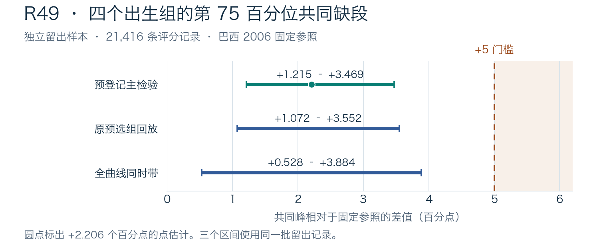
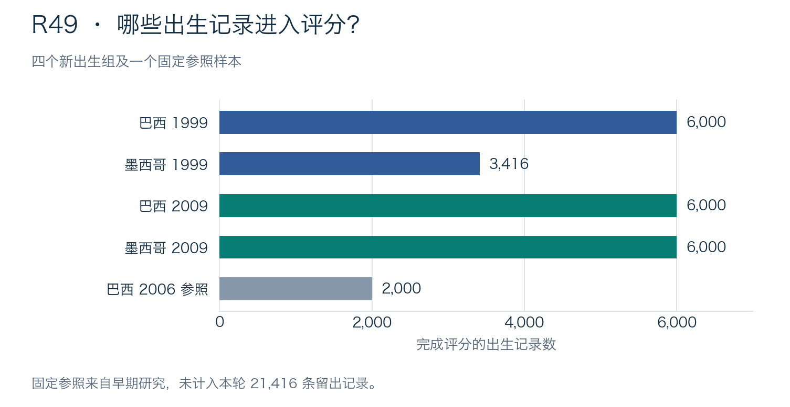

# 开放命盘研究

[English](README.md) · [研究纲领](docs/RESEARCH_PROGRAM.zh.md) · [研究宪章](CONSTITUTION.zh.md) · [研究进展](RESEARCH_STATUS.zh.md) · [复算与复核](#复算与复核)

所谓年轻世代的「命理断层」，能否写成其他研究者可复验的问题？本项目使用有出处的出生档案、版本固定的四套算法及预先登记的比较，检验模型中的缺段是否集中在相同年龄或公历时期。

**当前结论。** R49 用巴西、墨西哥四个档案框的 **21,416 条独立留出出生记录**，在第 75 百分位口径下排除了预登记的 **+5 个百分点**共同缺段。共同峰估计为 **+2.206 个百分点**，主检验区间为 **+1.215 至 +3.469**。东亚及其他人群是否出现同样结果，仍未分辨。[R49 证据](R49.md) · [最新外部资料核查](R51.zh.md)

## 项目实际测量什么

在足岁 20–59 的每一年，四套指定算法各给一个年度分数。R49 以巴西 2006 固定样本按年龄段校准各体系的第 75 百分位。有至少三体系达到各自边界的一年，记为联合高分年。十年内这类年份为零，就记为一个缺段。每条记录的缺段指标先扣除自身 31 个候选窗口的均值，再与固定参照的同龄值比较。

四组「共同峰」先在每个起始年龄取四组效应的最小值，再取各年龄中的最大值。因此检验的是**四组同时出现**的共同集中。R45 所用固定参照已有 **99.95%** 的记录至少能找到一个十年缺段，真正进入检验的是缺段在同一窗口是否更集中。四套算法共享部分历法与天文输入，分数之间可能相关。[指标与参照定义](rounds/r45/REGISTRATION.zh.md) · [R49 主检验登记](rounds/r49/REGISTRATION.zh.md)

## 最新独立样本得到什么结论



| 在 R49 留出样本上使用的方法 | 区间（百分点） | 对 +5 的判断 |
| --- | ---: | --- |
| 预登记主检验，四组校正 | +1.215 至 +3.469 | 在所检档案框内排除 |
| 回放 R46 原来预选组的方法 | +1.072 至 +3.552 | 排除 |
| 跨组、跨起始年龄的 95% 同时带 | +0.528 至 +3.884 | 排除 |

共同峰出现在 **34–43 岁**。三个区间都容许更小量级的共同效应，结论限于指定档案框和算法。上表三种方法使用同一批留出样本。[机器可读结果](rounds/r49/results.json) · [独立算术复核](rounds/r49/review.json)

**R46 两种判断为何不同？** 上界 **+5.223** 和 **+4.685** 都出现在 34 岁窗口，前者由预选的巴西 2009 组给出，后者允许四组共同约束，校正后由墨西哥 2009 组给出更低上界。R49 事先登记组间校正，并在新样本复做两种辅助方法，三种上界均低于 +5。[逐年龄上界图](rounds/r49/upper_bounds.png) · [R46 分歧复算](rounds/r49/R46_DIFFERENCE.zh.md)

## 结论覆盖哪些出生记录



| 出生组 | 留出评分数 | 合格来源余框 | 适用范围 |
| --- | ---: | ---: | --- |
| 巴西 1999 | 6,000 | 43,348 | 原时分合格框集中在阿拉戈斯州。 |
| 墨西哥 1999 | 3,416 | 3,416 | 2013–2016 年晚登记档中查到的合格实际 1999 年出生记录全量。 |
| 巴西 2009 | 6,000 | 2,745,932 | 在 SINASC 排除前轮记录后的合格余框分层抽取。 |
| 墨西哥 2009 | 6,000 | 1,637,435 | 用 2009–2010 年档重建实际 2009 年出生框，并排除前轮记录后分层抽取。 |
| 巴西 2006 参照 | 2,000 | 固定比较样本 | 来自前轮，独立于本轮 21,416 条留出记录。 |

是否纳入取决于出生日期、时分、登记性别、实际发生地与来源凭据是否可核。抽样权重只代表合格框。四组之间及与前轮按官方原档物理行复查互斥，跨档的个人身份无法核对。部分实际出生地以可核的市镇或地区坐标近似。[样本封存](rounds/r49/seals) · [原档重建复核](rounds/r49/source_review.json) · [资料条款](data_expansion/DATA_LICENSES.md)

## 研究如何走到现在

| 研究 | 主要结果与边界 |
| --- | --- |
| **R8 · 四体系结构的一致性** | 评分 **3,729 条来源记录**，来自巴西 2006、Open Gauquelin Database 和 Astro-Databank 免费 Z 档。六项预先规定的比较经 Holm 校正后均未拒绝指定的独立相位参照，最小校正 p 值为 **0.183**。 |
| **R10 · 原四体系独立复算** | 完成六组 **12,000 条**记录的复算，墨西哥两组模型输入散列与原记录一致。两份原始抽样说明仍未找回，公开的是以官方档案独立重建并复核的抽样资料。 |
| **R45–R46 · 较大缺段还有多大空间** | 第 80 百分位下，R45 的同龄、同公历上界分别为 **+3.93**、**+3.59 个百分点**。R46 的 2009 年整点对照排除了 +5，其第 75 百分位检验出现分歧，由 R49 用独立记录复验。 |
| **R48 · 能否连续排出运段** | 核过 **6,766 条**出生记录，指定八字法和两种紫微起限法均连续覆盖所检成年阶段。流传说法的原始出处和通用判定规则仍待核实。 |
| **R47 与 R50 · 能否迁移到其他档案** | R47 的日本官方日期与小时计数涉及 **148,030 次**出生。在该轮第 80 百分位下，可行分配落于 +5 两侧。R50 核查的日本、美国资料没有达到固定年龄第 75 百分位复验的条件，并验证了档案所在地可执行的计算方法。 |
| **R51 · 日本以外的东亚路径** | 优先资格确认香港医管局 2009 年档、浙江 1999 或 2009 年档。研究版的历史分钟字段及本用途许可仍待核实。R51 没有新增外部记录评分。 |


R8 图以记录内第 80 百分位和年龄段内轮换作为相位参照。R45、R49 以固定出生组作为跨人群参照，研究缺段的集中程度。每张图按其本轮定义解读。[R8 原报告及图表](https://github.com/CPTM511/open-birth-chart-study/blob/210bb7bdab85a9f3672f19241e9ef66eb22021a2/README.zh.md) · [R10](R10.md) · [R45](R45.md) · [R46](R46.md) · [R48](R48.md) · [R47](R47.md) · [R50](R50.zh.md)

R8 将固定子样本的出生钟点移动 ±30 分钟后，三体系联合高分判定在所检记录年份中改变 **2.35–3.13%**，西方占星单体系判定改变 **23.93–24.98%**。这是指定算法分类对钟点的敏感性。R46 随后在两组 2009 年档案直接检验整点处理。[R8 钟点敏感性图](figures/04_clock_sensitivity.png) · [R46 后续检验](R46.md)

## 四套算法及其边界

| 体系 | 用于研究的结构信号 | 重要边界 |
| --- | --- | --- |
| 八字 | 原局四支与流年、在行大运地支的六冲。 | 旺衰、格局优先级、有效用神和救应还没有完整裁决。 |
| 紫微斗数 | 大限、流年的化忌是否落入对应的命宫或疾厄宫。 | 不同起限法可改变宫位，混合格局还需明确判法。 |
| 七政四余 | 指定行限下的本命、行星、宫宿接触。 | 月孛及相关点位有现代计算近似，其他传统行限分支需独立核验。 |
| 西方占星 | 由行运、次限行星与次限轴构成的几何硬相位指标。 | 分数对应指定几何关系和取样规则，现实预测需要单独的结局研究。 |

项目公开版本参数、时间转换、适用范围与已知缺口。分位边界衡量模型输出。真实事件、个人预测及 AI 的社会影响，各有独立的数据和设计要求。[四体系完成度](docs/four_system_readiness.md) · [八字与紫微](docs/bazi_ziwei_methods.md) · [七政与西方占星](docs/qizheng_western_methods.md)

## 还需要解决什么

| 未决问题 | 什么证据可以推进 |
| --- | --- |
| **34 岁的第 75 百分位结果能否迁移到巴西、墨西哥以外？** | 优先核查其他东亚同期档案。同条记录须保留当地出生全日期、时分、登记性别和实际发生地，有该用途许可且样本互斥。先登记档案框和区间方法，再按巴西 2006 固定参照及 +5 门槛评分。 |
| **登记方式能否改变外部复验的判断？** | 在同一外部样本上预先指定实录钟点、取整或地点精度对照，报告哪些差异足以使判断跨过 +5。 |
| **研究对应哪一条可检验的传统断言？** | 找到可归属原文，给出能区分字面排不出运段与结构指标缺段的操作判据。替代模型先用有出处的例子验证，再正式检验。 |

R52 已向香港医管局和杭州市档案馆发出资料利用咨询，申请资格、历史字段及用途许可待核。R50 的固定参照及已复核方法可用于获准档案的原处计算。现实结局和 AI 实证按宪章分别立项。[R52 申请进展与研究说明](R52.zh.md) · [R51 重开证据](R51.zh.md#按什么证据重开) · [R50 计算方法](R50.zh.md) · [研究优先级和验收标准](docs/RESEARCH_PROGRAM.zh.md)

## 复算与复核

R49 以独立读档路径从官方档案回查全部 **21,416 条**留出记录，以冻结引擎重跑 **256 条**记录的 **40,960 项**评分，并以独立统计方法核对包括参照在内的 **3,746,560 项**判定，复现预先登记的结论。这些是项目内部的计算复核。[原档复核](rounds/r49/source_review.json) · [独立统计复核](rounds/r49/review.json) · [跨环境复算](rounds/r49/platform_replay.json)

1. **查结果及预登记。** R49 公开方案、来源封存、分组估计、代码和独立复核。[R49 复算指南](rounds/r49/REPRODUCE.md) · [R50 固定参照与复核](R50.zh.md)
2. **核验公开发行。** 使用完整克隆、Python 3.12 以上及 Node 24。历史校验从原发行提交读取 R8 首页与 R9 工作流，再逐一查验当前版本中的其余受保护路径。[历史复算](docs/REPRODUCING.md)

   ```sh
   python -m pip install -r requirements.txt
   npm ci --ignore-scripts
   PYTHONPATH=src python -m unittest discover -s tests -v
   python scripts/verify_frozen_releases.py
   ```
3. **重画首页图表。** 两张 R49 图只读取已发布的聚合值。安装 `requirements-publication.txt` 的绘图依赖，填入本机的简体中文字体路径后运行 `python scripts/make_readme_figures.py --cjk-font <font-file>`。[绘图代码](scripts/make_readme_figures.py)

完整复算须按来源条款访问原档。仓库公开获准的汇总、来源与软件凭据和发行核验。各轮计算复核记录了哪些输入和算术被再次核对，以及是否重跑了引擎的部分记录。[来源与软件](docs/PROVENANCE.md) · [参与指南](CONTRIBUTING.md)

## 引用及使用条款

请引用具体研究轮次与提交。代码使用 AGPL-3.0-or-later，原创文字、图表和聚合结果采用 CC BY 4.0。第三方资料沿用各自条款。[引用](CITATION.cff) · [代码许可](LICENSE) · [内容许可](LICENSE-CONTENT.md) · [R8 中文文章](articles/substack.zh.md) · [R8 English article](articles/substack.en.md)
