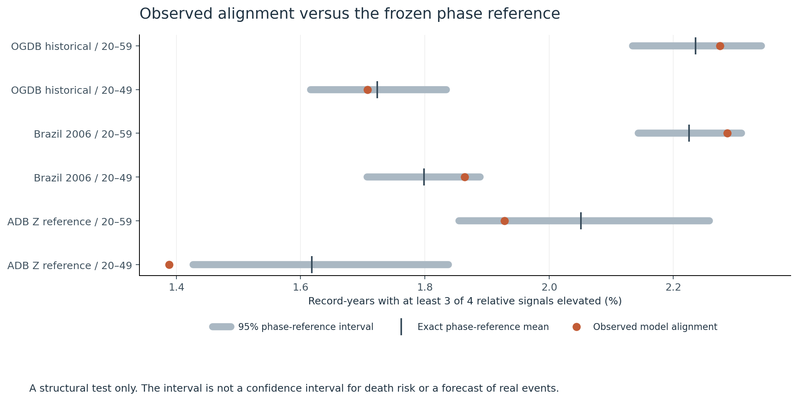

# Open Birth Chart Study｜公开命盘研究

本项目把四个明确版本的命盘流程用于真实公开出生资料，检验指定结构指标是否在同一年异常重合。

**R8 实际完成：3,729 条来源记录、每条 40 个年龄点、四体系计算；共 149,160 个记录年、596,640 个体系年度分数，以及 2,800 组敏感性计算。六项主要检验经 Holm 校正后均未达到显著性，最小校正后 p=0.183。**

这是四个选定结构模型的结果。本轮没有进行死亡结局验证，没有估算预测准确率，也没有取得全球代表性个人样本。

[English](README.md) · [中文文章](articles/substack.zh.md) · [英文主稿](articles/substack.en.md) · [复现步骤](docs/REPRODUCING.md) · [方法](docs/statistical_design.md)

## 数据范围

| 来源 | 实际读取源记录 | 合格样本框 | 实际四体系样本 | 出生范围 |
|---|---:|---:|---:|---|
| 巴西 SINASC 2006 | 2,944,928 | 2,805,207 | 2,000 | 2006 年 |
| OGDB 2023 年导出 | 25,869 | 1,388 | 1,388 | 1880–1962 |
| ADB 免费 Z 样本 | 483 | 341 | 341 | 1880–2014 |

三源共出现 32 个国家标签，但现代样本主要来自巴西一个出生年份。ADB 仅补充 42 条 1980–2019 年出生记录，其中 90 后 14 条；整个合格 ADB 样本仅一条中国出生记录。四对跨库记录可能重合，尚未核实为同一人。**不能据此代表中国90后、00后或全球人类。**

巴西出生地采用官方市镇行政驻地参考点；历史时区有歧义的记录被排除。权重只对应实际合格来源样本框。完整清洗、缺失、偏差和来源哈希见[数据报告](data_expansion/README.md)。读取近 300 万条源记录不等于计算了近 300 万张命盘。

## 六项结果

“一致率”指同一记录年中至少三体系达到各自预定相对高阈值的比例，不是死亡率。

| 来源 | 周岁窗口 | 实际一致率 | 独立相位参考均值 | 原始 p | Holm 校正 p |
|---|---|---:|---:|---:|---:|
| OGDB | 20–59 | 2.275% | 2.236% | 0.4725 | 0.945 |
| OGDB | 20–49 | 1.707% | 1.723% | 0.7665 | 0.945 |
| 巴西2006 | 20–59 | 2.287% | 2.225% | 0.1360 | 0.680 |
| 巴西2006 | 20–49 | 1.864% | 1.798% | 0.1590 | 0.680 |
| ADB Z | 20–59 | 1.928% | 2.051% | 0.2255 | 0.680 |
| ADB Z | 20–49 | 1.388% | 1.618% | 0.0305 | 0.183 |

最小原始 p 对应的是 ADB 20–49 岁的重合**偏少**，校正后亦不显著。未达到显著性不证明所有传统规则都无效；它表示这六项预先定义的整体一致性检验没有提供显著偏离参照的证据。

年度曲线仍有局部峰值，未进行逐年事件预测验证或逐峰显著性检验。四体系共享出生资料、历法与部分星历，不能当作四份独立实证证据。

[完整机器可读结果](results/structural_results.json) · [年度序列](results/annual_2026_2070.csv) · [敏感性](results/sensitivity_results.json)

## 实现深度与限制

八字完成四柱、起运、大运流年及14条条件规则；紫微完成命身宫、主辅星、四化、大限流年及5条条件规则；七政完成指定十一曜、28宿与固定运限版本；西占完成本命、行运、次限及轴推进。

尚未完成的是完整传统旺衰、格局优先级、用神及救应裁决，七政依命度行限和清代月孛原法等。**不能把指定计算流程完成，写成完整四体系寿命预测已获验证。**详见[四体系完成矩阵](docs/four_system_readiness.md)。

29项引擎测试和10项统计测试通过；另一代理对真实汇总做了495项独立算术比较，均一致。这属于项目内部计算复核，不是外部人类同行评议。时间偏移±30分钟，会使固定子样本中约23.93–24.98%的西占年度高指标分类改变；至少三体系一致的分类改变2.35–3.13%。这些是模型分类变化，不能解释成现实风险变化。

## 透明披露与合作

代码和协议在真实队列计算前本地封存，但没有事先公开注册。巴西抽样配额算法与协议文字有一处差异，最少相当于重分配22个名额，占2,000条的1.1%；原方案、实际实现和差异均保留，未重抽样。详见[偏差记录](docs/sampling_implementation_deviation.md)。

公开仓库提供方法、代码、汇总结果、图表、重建脚本及许可允许的最小OGDB数据。SINASC与ADB个人输入由复现者从原发布方下载，仓库不再分发；不公开个人寿命判断。R7旧试验单独保留，重复使用的ADB资料不会被称为新的独立盲测。

欢迎补充可信的公开出生时刻数据、原典条件规则、历法反例和独立复算。具体提交要求见[贡献指南](CONTRIBUTING.md)。本轮结果没有为“年轻一代将集中死亡”的传闻提供证据；这一结论不应被扩大为对所有命理主张的证明或证伪。
