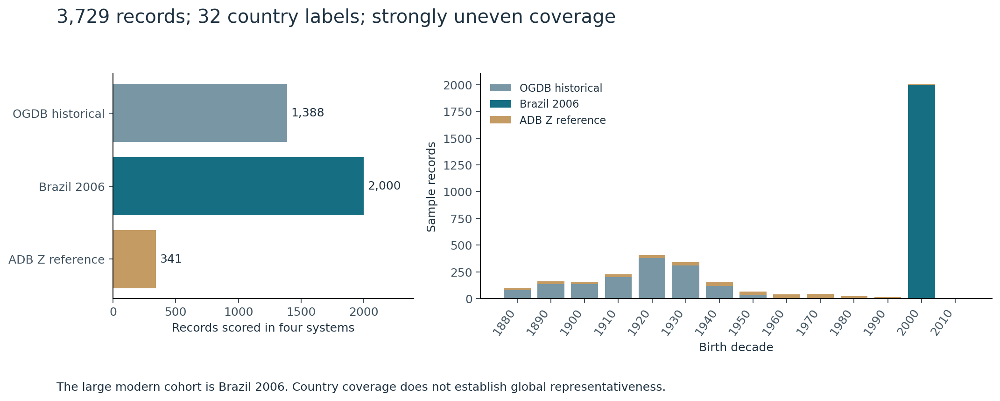
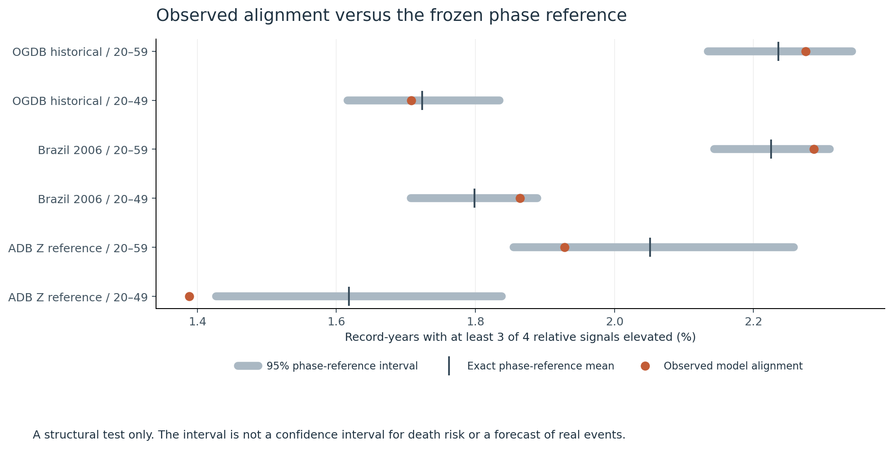
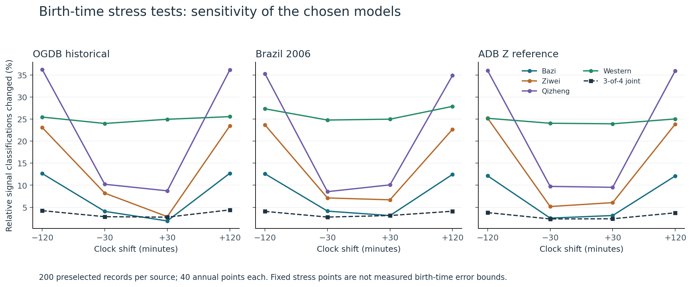

# Testing a Generational Astrology Rumor with Public Birth Data

We computed four specified astrological models for **3,729 public-source birth records**, producing **596,640 annual system scores**. Across six comparisons, the chosen signals showed **no statistically significant departure from the defined phase reference after correction for multiple testing**.

This is a result about the alignment of model outputs. It is not a finding about death rates. No mortality outcomes entered this analysis, and independent mortality testing remains paused.

The project began with a disturbing claim: people born in the 1990s or 2000s supposedly have birth charts whose middle-age periods disappear, implying widespread premature death. Before accepting such a claim, we need identifiable rules, traceable inputs and a comparison that could produce an unfavorable result for the claim.

Our current study supplies part of that foundation. It makes four calculation workflows reproducible, tests a defined form of cross-system concurrence and measures sensitivity to uncertain birth information. It does not establish a globally representative sample or a validated forecast of real events. The [aggregate results](../results/structural_results.json) and [frozen protocol](../protocol/study_protocol.json) specify that boundary.

## What the data actually cover

We assembled three sources and analyzed them separately:

| Source | Records scored | Coverage and selection |
|---|---:|---|
| Brazil SINASC 2006 | 2,000 | One birth year; all 27 Brazilian state-level units; sampled from 2,805,207 records meeting the declared eligibility rules. |
| Open Gauquelin Database | 1,388 | Births from 1880–1962 across six country labels, heavily concentrated in France, the United States and Italy. |
| Astro-Databank Z sample | 341 | A reused alphabetical reference collection spanning 1880–2014 and 31 country labels. |

The union contains **32 country labels**, but geographical breadth alone does not produce a representative sample of humanity. The large modern cohort is entirely Brazilian and born in 2006. Astro-Databank contributes only **42 births from 1980–2019**, including **14 from the 1990s**. There is **one China-labelled record overall**. These data cannot support population conclusions about China's 1990s or 2000s generations.

These are source records, not 3,729 identity-verified independent people. Four possible overlaps between the two historical/reference collections remain unresolved. Keeping sources separate avoids presenting their combined count as an independent pooled cohort.

The original publishers are [Brazil's Ministry of Health](https://dadosabertos.saude.gov.br/dataset/sistema-de-informacao-sobre-nascidos-vivos-sinasc), the [Open Gauquelin Database](https://opengauquelin.org/downloads2) and [Astro-Databank](https://www.astro.com/adbexport/). The [data audit](../data_expansion/README.md) records exclusions, source hashes and sampling details.

Brazilian coordinates are official municipal-seat reference points, not observed hospital locations. Times are recorded to the minute, without a measured accuracy guarantee. Historical time-zone ambiguity, missing prerequisites and contradictory clock information prompted exclusions. The resulting weights describe the eligible source frame, not all Brazilian births or the world.

*Coverage is uneven. A large single-year cohort and two selected collections answer a narrower question than a global birth survey would.*

## Four explicit models, with visible limits

Each system requires choices about calendars, time, placement rules and interpretation. We fixed a version before inspecting cohort signals.

| System | Implemented workflow | Annual primary signal |
|---|---|---|
| Bazi | Four pillars, hidden stems, ten gods, starting-period timing, decadal periods and annual pillar. | Six-clash matches between annual/decadal branches and four natal branches, divided by eight comparisons. |
| Ziwei Doushu | Twelve palaces, major and subsidiary stars, brightness, transformations and decadal/annual maps. | Mean of two indicators: whether annual and decadal Hua Ji's natal-star positions fall in the corresponding life/health palaces. |
| Qizheng Siyu | Seven luminaries, four explicitly defined additional points, twelve palaces, 28 unequal mansions, selected major/minor periods and monthly transits. | Equal mean of five specified palace/mansion contact channels involving natal and transiting configurations. |
| Western astrology | Ten planets, whole-sign houses, major aspects, monthly transits, secondary progressions and progressed axes. | Weighted contact index: 50% transits, 25% progressed planets and 25% progressed axes. |

Bazi and Ziwei use a July annual snapshot; Qizheng and Western use twelve monthly snapshots. These are finite observations, not continuous monitoring. Detailed definitions, actor sets, orbs and code versions are in the [implementation inventory](../docs/four_system_readiness.md).

The scalar signals are research definitions. They do not constitute complete traditional judgments. Bazi also implements 14 conditional clauses, but lacks a complete resolution of strength, pattern priorities, useful elements and rescue conditions. Ziwei implements five conditional clauses without resolving every pattern or counteracting influence.

Qizheng has particularly material limits. Yuebo uses modern mean lunar apogee as an approximation to the Qing definition. Its Ming placement is a discrete palace rule; the selected fixed major periods do not implement a complete degree-based progression. The original mansion table and alternate-source discrepancies remain documented. Western astrology likewise represents one specified transit/progression workflow, without a complete interpretive or lifespan model.

These limitations are traceable to [classical-source and dependency records](../docs/PROVENANCE.md), including the [Ziwei text](https://zh.wikisource.org/wiki/紫微斗數全書/卷三) and [Qizheng mansion table](https://zh.wikisource.org/wiki/皇朝通志_(四庫全書本)/卷019). Four functioning engines should not be described as four complete classical mortality judgments.

## What we tested

Every record produced a complete **40-year trajectory, ages 20–59**, in each system: 149,160 record-years and 596,640 system-year scores. Ages are completed civil ages on July 1. Historical trajectories include historical calendar years; they are not all forecasts for 2026–2070. Computed years must not be confused with observed years lived.

We ranked each system's 40 annual scores within the same person's trajectory. An annual signal was “elevated” when its midrank percentile was at least 0.8. Tied values share a rank, so this does **not** force exactly 20% of years to be elevated. For example, the Brazilian Bazi model classified about 16.60% of record-years as elevated under this rule. A zero score means that the selected index found no counted configuration; it says nothing about whether a person is alive.

The comparison statistic was the source-weighted proportion of record-years with **at least three of four signals elevated together**. We tested ages 20–59 and, separately, 20–49. The shorter window retained the original 40-year ranks.

For the reference, each system's sequence was independently circularly shifted within each person's ten-year age bands. This preserves the chosen signal frequencies and coarse age structure while changing their relative timing. Identical chart inputs share shifts. We used 1,999 draws, a fixed seed and two-sided deviations from the exact reference mean, then applied Holm correction across all six comparisons.

This is a conditional phase reference, not a model of human births or deaths. It does not preserve every cross-person or cross-decade dependency. The systems also share birth inputs, calendar ancestry and astronomical calculations. Their concurrence is not four independent empirical votes.

## The results

“Observed” below means the proportion of record-years meeting the three-of-four rule. The reference column is its exact expectation under the specified phase shifts. P-values are Monte Carlo values; all six are reported without selection.

| Source | Ages | Observed | Reference mean | Raw p | Holm-adjusted p |
|---|---|---:|---:|---:|---:|
| OGDB | 20–59 | 2.2749% | 2.2356% | 0.4725 | 0.945 |
| OGDB | 20–49 | 1.7075% | 1.7235% | 0.7665 | 0.945 |
| Brazil 2006 | 20–59 | 2.2867% | 2.2253% | 0.1360 | 0.680 |
| Brazil 2006 | 20–49 | 1.8640% | 1.7985% | 0.1590 | 0.680 |
| ADB Z reference | 20–59 | 1.9282% | 2.0511% | 0.2255 | 0.680 |
| ADB Z reference | 20–49 | 1.3881% | 1.6183% | 0.0305 | 0.183 |

Source: [complete numerical table](../results/primary_tests.csv).

None meets the adjusted 0.05 threshold. The smallest raw p-value concerns **less** concurrence in ADB ages 20–49, not an excess. Its adjusted p-value is 0.183. The largest positive difference is about 0.0655 percentage points, in Brazil ages 20–49.

*Intervals describe the phase reference. They are not confidence intervals for mortality or population risk.*

These results do not support unusual alignment under the selected reference and definitions. They also do not prove that every possible astrological interpretation is false. The conclusion concerns the explicit tests performed.

We separately publish [2026–2070 calendar curves](../figures/03_calendar_profiles.png). Their membership changes with age eligibility. OGDB has no eligible records in that window; the Brazilian cohort has none by 2070, while ADB has only three. An empty year means no eligible records, not vanished life periods. Peaks in these descriptive curves cannot be read as population danger forecasts.

A [post-result descriptive check](../results/exploratory_calendar_mechanism.json) helps explain the calendar structure. Of the 2,000 Brazilian records, 1,824 have the Bazi birth-year branch Xu. The years 2036, 2048 and 2060 have Chen, which the chosen index counts as opposing Xu. That supplies a shared term every twelve years. In 2060, concurrence reaches 6.945%; Bazi's mean relative percentile is 0.8285, while the other systems average about 0.48–0.50. This identifies a mechanical contributor, not an exhaustive explanation of the joint peak. No annual-peak significance test was run, and this check was not part of the frozen hypothesis tests.

## Birth information changes the outputs

We computed **2,800 additional stress profiles**: four clock shifts for 200 preselected records per source, plus four coordinate shifts for 100 Brazilian records. These were fixed stress points, not measured error bounds.

The table shows the percentage of annual elevated/not-elevated labels that changed, ranging across source and shift direction:

| Model | Clock shift ±30 minutes | Clock shift ±120 minutes |
|---|---:|---:|
| Bazi | 1.90–4.13% | 12.09–12.70% |
| Ziwei | 2.88–8.20% | 22.68–25.19% |
| Qizheng | 8.54–10.21% | 34.89–36.23% |
| Western | 23.93–24.98% | 25.03–27.88% |

The joint three-of-four classification changed in **2.35–3.13%** of record-years under ±30 minutes and **3.74–4.40%** under ±120 minutes. This measures turnover in individual classifications, not an equal increase in the aggregate rate: some years enter while others leave.

Shifting the Brazilian reference coordinates by ±0.25° in one coordinate at a time changed Western annual labels in **0.85–3.60%** of record-years and joint labels in **0.025–0.275%**. The other primary indices did not change in those geographic stress cases. That follows from these conventions and sampled cases; it is not a universal claim of geographic insensitivity. Full results are in the [sensitivity aggregate](../results/sensitivity_results.json).

## Calculation checks and research transparency

The four engines passed 29 implementation test methods. Separate astronomy checks covered ten bodies at five dates; the largest difference against Astronomy Engine was 11.832 arcseconds when terrestrial time was matched. Such agreement checks position calculations, not whether those positions predict human events.

A direct check against an [1833 Chinese almanac](https://commons.wikimedia.org/wiki/File:NLC892-411999011532-17590_大清道光十三年七政經緯躔度時憲書.pdf) illustrates both progress and limits: Zi Qi's maximum discrepancy was 0.573 arcminutes across twelve dates, while the mean-apogee Yuebo approximation differed by up to 34.851 arcminutes. The [reference transcription and errors](../docs/engine_validation/1833_reference.json) remain inspectable.

Our protocol was **frozen locally, not publicly preregistered**. We also found a sampling implementation deviation: Brazil's actual quota allocation differed from the written rule by a distance equivalent to **22 of 2,000 slots**, across 35 strata. This was discovered after profile computation began but before the team reviewed statistical effects. We retained the original samples and disclosed the discrepancy; no resampling occurred. Source weights do not erase it. The [audit](../docs/sampling_implementation_deviation.md) records the exact difference.

A separate project AI agent reviewed the statistical implementation and synthetic checks. That is an additional internal check, **not external human peer review**. The [review record](../docs/analysis_independent_review.md) explains its scope and corrections.

The same separate reviewer also independently recomputed the deterministic result arithmetic using Python's standard library, without importing the main analysis implementation: 495 comparisons across all six tests and sixteen stress groups agreed to floating-point precision. It did not rerun the 1,999 simulation tail counts. The [numerical review](../docs/result_numerical_review.md) records that distinction.

The earlier [R7 pilot](../baseline/r7/README.md) remains separate. Reused data are not newly blinded evidence. No test in this release validates a generational death prediction.

## An open project others can improve

The repository provides versioned methods, code, aggregate results, source provenance and [reproduction instructions](../docs/REPRODUCING.md). Individual model profiles are not published. Public-source data retain their own redistribution terms.

Useful contributions are specific: additional public birth sources with documented selection and clock quality, especially for China and the 1990s; independent classical-method reviews and reproducible counterexamples; alternative phase references that preserve more shared dependencies; and external replications of the frozen calculations.

Any later claim of predictive validity will require a separately specified outcome study, appropriate baselines and genuinely unseen evidence. The current release gives that work an auditable starting point. It supplies no basis for treating this rumor as an established forecast about a generation's lifespan.
