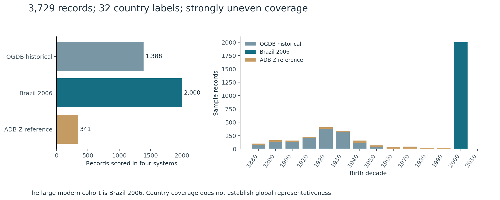
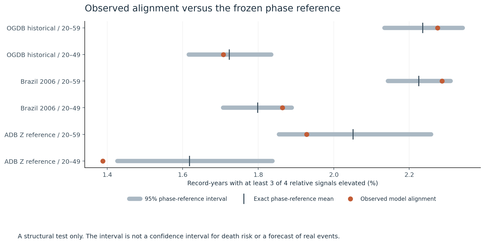
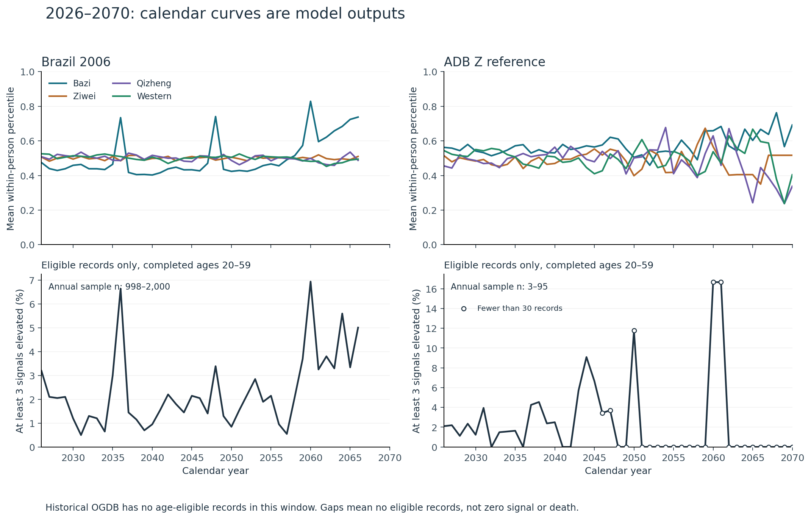
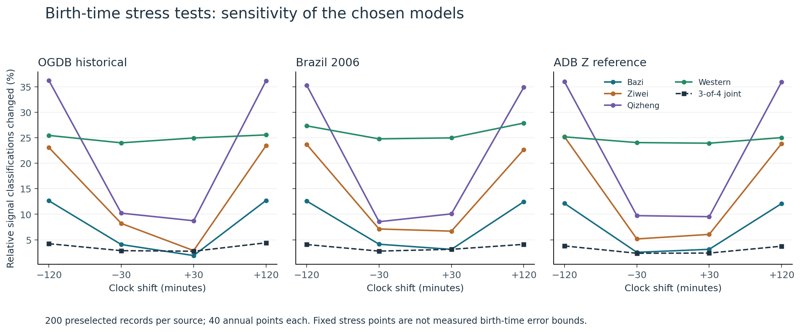

# 把“00后命盘断档”传闻变成一个可复核的研究

**公开出生资料、四体系计算与一次有明确边界的结构检验**  
Open Birth Chart Study · R8 · 2026年11月26日

这次研究没有为“年轻一代的命盘预示集中死亡”提供证据。

我们对3,729条真实公开出生记录，计算了八字、紫微斗数、七政四余和西方占星四个明确版本的年度指标。六项预先规定的整体一致性检验，经多重比较校正后均未达到显著性，最小校正后p值为0.183。

这个结果的范围需要说清楚：本轮检验的是四组指定命理结构是否异常重合，没有验证死亡结局，也没有得到全球代表性样本。它不能证明所有命理规则都无效，同样不能被改写成未来灾难或寿命预报。[完整结果](../results/structural_results.json)

## 先把传闻拆成能检验的问题

研究的起点，是一种关于90后、00后的说法：把出生八字集中排开，会发现许多人在20岁到50岁，或者20岁到60岁之间“没有后面的命”，进而有人把它解释为集中死亡。

目前，这个说法没有在本项目中落实为一个可核验的原始出处、清晰的人口分母和固定判断规则。“没有”究竟是排盘软件没有显示、大运计算有范围限制，还是解释者认定某种组合代表凶险，也没有统一定义。

只凭出生资料，程序可以计算未来历法位置；它不会自动知道一个人是否活着。因此，能排出后续运程，不是生存证明；某个界面没有显示，也不能直接当作死亡证据。

我们把本轮问题收窄为：**在固定规则下，四个体系的相对高指标，是否比一个明确的独立相位参照更容易同时出现？**同时考察2026—2070年的年度曲线，以及出生时间和地点误差会怎样改变计算。[问题与验收边界](../docs/RESEARCH_QUESTIONS.md)

## 数据扩大了，代表性仍然有限

这一轮实际读取了三个公开来源，共2,971,280条源记录。完成清洗与抽样后，进入四体系计算的是3,729条。

| 来源 | 实际读取记录 | 符合当前输入要求 | 实际计算样本 | 出生范围 |
|---|---:|---:|---:|---|
| 巴西SINASC出生登记 | 2,944,928 | 2,805,207 | 2,000 | 2006年 |
| Open Gauquelin Database | 25,869 | 1,388 | 1,388 | 1880—1962年 |
| Astro-Databank免费Z样本 | 483 | 341 | 341 | 1880—2014年 |

这些是实际下载和处理的数据，不是合成出生信息。[SINASC官方来源](https://dadosabertos.saude.gov.br/dataset/sistema-de-informacao-sobre-nascidos-vivos-sinasc)、[OGDB下载说明](https://opengauquelin.org/downloads)和[ADB官方样本说明](https://www.astro.com/adbexport/00_readme.html)可以直接查阅；每份档案的大小、哈希和清洗过程在[数据报告](../data_expansion/README.md)中保留。

三源合计出现32个国家标签，但现代样本主要来自巴西2006年。ADB只有42条1980—2019年出生记录，其中90后14条、00后3条；整个合格ADB样本只有一条中国出生记录。OGDB则主要来自欧洲和美国，而且男性占明显多数。另有四对跨库记录可能属于同一人，尚未完成身份确认。

所以，3,729是来源记录数，不是已核实的独立人数；32个国家也不等于全球代表性。**这份样本不能替中国90后、00后，或者全世界同龄人口作结论。**读取近300万条源数据，更不能写成已计算近300万张完整命盘。

数据质量也比“有年月日时”复杂。巴西使用官方市镇驻地参考坐标，不是医院或精确出生点；部分地区无法确定历史时区，夏令时折返又会造成一个本地时刻对应两个绝对时刻，这些记录被排除。约65%的完整出生时刻，其分钟数是5的倍数，说明钟点文本不能直接当作精度保证。所有2,000条入选巴西记录，均已回查原始档案。

历史档案也不能因为被收入数据库就自动升级为出生证明。OGDB中大量记录没有明确性别；在其余条件满足后，又有233条因本地时间、绝对时间与时差不能在1秒容差内相符而被排除。保留这类筛选过程，才能知道最终样本究竟代表了什么。

## 四体系分别算了什么

我们把排盘、结构指标和完整传统解释分开说明。

| 体系 | 本轮计算流程 | 进入主要检验的指标 |
|---|---|---|
| 八字 | 四柱、节气、起运、大运、流年；14条有出处的条件规则 | 流年／大运地支与四个本命地支的六冲配对比例 |
| 紫微斗数 | 命身宫、主辅星、四化、大限与流年；5条条件规则 | 流年／大限化忌是否进入各自对应的命宫或疾厄宫 |
| 七政四余 | 指定十一曜、完整不等宽28宿、选定固定大限与小限、逐月流曜 | 五组预先固定的宫位／星宿接触量 |
| 西方占星 | 十星本命、整宫制、逐月行运、日年次限、Naibod轴推进 | 行运、次限行星与推进轴的固定几何接触指数 |

这些指标均有具体计算定义，不能直接叫作死亡概率。八字、紫微的条件规则保留了适用前提、歧义与救应候选；它们没有被强行合并成一个“最终凶险分”。原典条件与所选实现见[八字／紫微方法](../docs/bazi_ziwei_methods.md)。

七政也存在明确的版本限制。紫炁采用有原典出处的历元和速度；月孛采用现代月球平远地点近似，没有完整重建清代原法。运限采用指定的固定年数版本，尚未实现完整依命度调整的行限方法。对照1833年原始历书，紫炁12个参考点的最大差异约0.573角分，月孛平远地点则约34.851角分。改成瞬时远地点后，最大差异反而约27.311度，不能把两个名称随意互换后仍称为同一算法。[七政／西占方法与原始核验](../docs/qizheng_western_methods.md)

全部实现通过29项引擎测试；两套天文程序另做了50个行星／日期位置比较。它们能支持相应计算的可复核性，不能证明占星解释对现实事件有效。完整传统旺衰、格局优先级、有效用神、救应成败与寿限判断，仍有重要部分没有实现。[四体系完成矩阵](../docs/four_system_readiness.md)

## 怎样比较四个不同尺度的指标

每条记录计算40个年度点，对应每年7月1日的周岁20—59岁；20—49岁是预先规定的第二窗口。2026—2070年的展示，只保留落在这些年龄范围内的年度。

对每个人、每个体系，把40个数值转换为自身轨迹内的平均秩百分位。达到0.8阈值记为相对高；同一年至少三体系达到阈值，才算一次重合。并列值共享平均秩，因此“达到0.8”并不严格等于每人最高20%的年份，常数轨迹也不会被标成高指标。

参照方法是在每个十岁段内，分别循环平移四个体系的年度标记。这样保留各指标出现的频率、同人年龄段和样本权重，但打乱体系之间的相对年份。我们计算1,999组参照，再对三来源、两个年龄窗口合计六项检验进行Holm校正。[统计方法](../docs/statistical_design.md)

这个参照有意检验“相位独立”。现实中的四体系共享出生资料、历法与部分天文位置，原本就可能不独立。因此，即使出现显著偏离，也只能说明模型结构对齐，不能自动证明四次独立预测同时成功。

## 实际结果：六项整体检验均未通过校正

| 来源 | 周岁窗口 | 实际重合率 | 参照均值 | 原始p | Holm校正p |
|---|---|---:|---:|---:|---:|
| OGDB | 20—59 | 2.275% | 2.236% | 0.4725 | 0.945 |
| OGDB | 20—49 | 1.707% | 1.723% | 0.7665 | 0.945 |
| 巴西2006 | 20—59 | 2.287% | 2.225% | 0.1360 | 0.680 |
| 巴西2006 | 20—49 | 1.864% | 1.798% | 0.1590 | 0.680 |
| ADB Z | 20—59 | 1.928% | 2.051% | 0.2255 | 0.680 |
| ADB Z | 20—49 | 1.388% | 1.618% | 0.0305 | 0.183 |

最小原始p值出现在ADB的20—49岁窗口，而且方向是重合偏少。若只展示0.0305，而省略方向与六项校正，就会制造一个比实际证据更强的故事。[原始结果表](../results/primary_tests.csv)

另一个代理用独立的标准库程序重算了实际重合率、精确参照均值、Holm校正和全部16个敏感性分组，共495项数值比较，没有实质差异。它没有重复1,999次模拟尾部计数，也不属于外部人类同行评议。[数值复核记录](../docs/result_numerical_review.md)

## 年度峰值为什么仍然值得谨慎

整体检验未显著，并不意味着年度曲线没有峰值。例如，巴西样本在2060年的三体系重合率约6.95%。这是一项描述性结果，没有被验证为那一年会发生的现实事件，也没有完成逐年峰值的显著性检验。

结果出来后，我们额外检查了一个可见的历法机制：2,000条巴西记录中，1,824条的八字年支为戌；2036、2048、2060年的年支都是辰。当前指标把辰戌相冲计入分数，因此同一出生年份的大量记录自然会出现共同的周期成分。2060年的八字平均相对百分位约0.828，另三体系约0.48—0.50。这个机制能解释一部分共同峰形，不能单独解释全部重合，更不能推出灾难。[事后描述性检查](../results/exploratory_calendar_mechanism.json)

ADB在后期某些年份只剩少数年龄合格记录，比例容易受一两条记录影响。OGDB历史组在2026—2070年没有符合20—59岁窗口的记录，图上相应缺失。这些空白来自年龄筛选，不能叫作“命断了”。

## 出生时间误差会明显改变个体结果

我们预先按固定哈希选出每来源200条记录，分别将出生时间移动±30和±120分钟；另对100条巴西记录做四个±0.25度的坐标压力点，共2,800组。

±30分钟已使西占相对高指标在约23.93%—24.98%的配对记录年发生改变；至少三体系同时为高的分类改变约2.35%—3.13%。±120分钟时，后一个比例为3.74%—4.40%。巴西坐标压力点的共同分类改变为0.025%—0.275%。这些数字衡量的是分类翻转，不是总重合率净变化，更不是死亡风险变化。[完整敏感性结果](../results/sensitivity_results.json)

压力点也不等于实际测得的误差范围。它们说明，在时刻精度没有独立保证的条件下，不适合把这些个体年度标签解释得过于确定。

## 把研究过程中的问题也公开

本轮协议、模型与输入哈希在实际队列计算前本地封存，但这不是第三方时间戳的公开预注册。

审阅发现，抽样协议文字与实际配额算法存在一处差异：巴西54个分层中35层的配额不同，最少相当于重分配22个名额，占2,000条的1.1%。我们保留实际样本，没有为结果重抽；原协议、实际算法和逐层差异均公开。[抽样偏差说明](../docs/sampling_implementation_deviation.md)

统计和汇总代码在实际效果计算前，也修复了权重维度、输入长度与来源标签映射等检查问题，修正记录保留在协议目录。可复核研究应让读者看到这些限制，而不是只留下一个通过检查的最终画面。

此前R7是另一组局部规则的小型回顾试验；其结果单独保留，不能因为本轮重新使用ADB档案，就变成新的独立盲测。本轮按研究范围暂停死亡结局验证。[R7记录](../baseline/r7/README.md)

## 下一步需要什么

目前能作出的判断是：**这些真实公开记录和指定四体系指标，没有提供足以支持代际集中死亡传闻的证据。**研究也尚不足以对全球人口、某一代中国人或所有传统命理规则作统一结论。

项目公开代码、方法、来源哈希、许可允许的数据、重建脚本、汇总结果与图表。个人SINASC／ADB输入需要从原发布方本地重建，不重复分发；也不公开任何人的寿命判定。

欢迎共同推进三类工作：补充欠缺地区和年代的可信出生时刻资料；把传统规则连同适用前提、反例与救应写成可审计的版本；独立复算并指出错误。如果未来恢复现实结局研究，还需要另外冻结规则、取得真正未查看或前瞻观察的结局，并处理年龄、人口基准和随访问题。

每一步都应允许结果为阴性、存在分歧，或者暂时无法判断。[项目说明](../README.md) · [复现指南](../docs/REPRODUCING.md) · [参与方式](../CONTRIBUTING.md)
