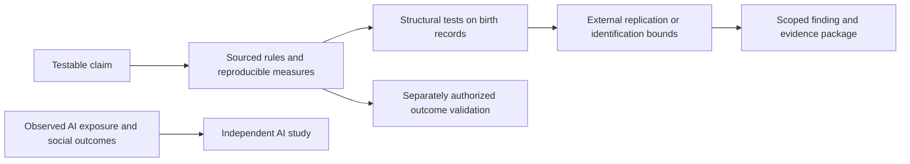

# Open Birth Chart Study Research Program

**Execution program v1.0 · Research direction after R49** · [中文](RESEARCH_PROGRAM.zh.md)

This program defines the research endpoint, priorities and acceptance criteria. The project constitution governs preregistration, review, privacy, authorization and revisions. Evidence determines when work advances. Every proposed study must identify a judgment its results could change. [Constitution](../CONSTITUTION.md) · [Research status](../RESEARCH_STATUS.md)

## 1. Ultimate goal

**Reach an independently auditable judgment on whether the claimed disruption in younger generations' birth charts replicates across populations.** Translate the motivating claim into explicit rules, a population, an age or calendar window and conditions that could overturn it. Test the resulting claim on independent birth records. Deliver a research report and a reproducible evidence package. Each finding states its applicable rules and population, the effect sizes supported or excluded, what remains unresolved and what new evidence could change the decision.

A longer-term question is whether any rule that generates a concrete prediction can outperform a reasonable baseline on previously unseen real outcomes. That step requires a separate, authorized validation study. The motivating question about AI and social disruption can follow the same evidence principles, using observed AI exposure, measurable social outcomes and its own identification design. [Original research questions](RESEARCH_QUESTIONS.md) · [Constitution](../CONSTITUTION.md)

A project stage is accepted on the quality and scope of its conclusions. Support, exclusion of a prespecified effect size and an unresolved result can each complete a study. An evidence audit can be complete while the scientific question remains unresolved. Give a verifiable reason, such as missing variables that allow values on both sides of the threshold or an interval that still crosses it in an admissible frame. Report counts of records, classical examples and research rounds as measures of coverage.

## 2. What R49 leaves to resolve

| Question | Evidence to date | Consequence for the next decision |
| --- | --- | --- |
| Can the programs literally produce continuous periods? | R48 checked 6,766 records. The specified Bazi implementation and two Ziwei methods produced continuous adult periods. The historical Ziwei interpretation can change palace placement. | The originating wording, denominator and decision rule of the circulating claim remain unverified. A sourced rule or counterexample that changes period coverage or the study decision can reopen this question. [R48](../R48.md) |
| Do all four cohorts share a gap of the prespecified size? | R45 excluded +5 percentage points for the tested age and calendar windows at the 80th percentile. R46 excluded +5 in the whole-hour comparison of the two 2009 cohorts. At the 75th percentile, R49 used 21,416 fresh records and found a same-age common peak of +2.206 and a primary upper bound of +3.469 percentage points. | The original threshold question is closed under the frozen models in those frames. Smaller effects, alternative definitions and other populations need their own claims. [R45](../R45.md) · [R46](../R46.md) · [R49](../R49.md) |
| What does the project measure? | Its scores represent documented structural signals. In R45, 99.95% of the fixed Brazil reference had at least one ten-year period without a joint high year. The study therefore measures concentration in a common window. | The link between the measured gap and traditional terminology still requires evidence. The systems share birth inputs and some calendar and astronomical cycles. Prioritize sourced rule differences, shared timing structure and data errors that can change the decision. [R45 results](../rounds/r45/RESULTS.zh.md) · [Implementation scope](four_system_readiness.md) |
| Does the finding transfer to other populations? | R49 used disjoint physical records. Some came from the same registry as earlier samples. In R47, minute and sex allocations consistent with the same Japanese date-hour counts for 148,030 births put the peak on either side of +5. | The key gap is a contemporaneous, authorized external frame with sufficient information for the comparison. Brazil 1999 is geographically concentrated. Mexico 1999 uses late registrations. Coverage of two birth years limits conclusions about entire generations. [R47](../R47.md) · [R49 source scope](../rounds/r49/RESULTS.zh.md) |
| Can the study predict events or identify an AI effect? | The birth-chart work has tested rules and model structure. The AI work has separate findings on adoption, employment and tasks, with different units and limits. | Each requires a defined real outcome, independent evidence and a prespecified identification design. The constitution governs any resumption of mortality-outcome research. [Constitution](../CONSTITUTION.md) · [R14](../R14.md) · [R17](../R17.md) · [R24](../R24.md) |
| Can the evidence be rebuilt in a fresh environment? | R49 published its registration and source digests. It rebuilt source inputs, reran a scoring subset and recomputed the aggregate independently. A full rebuild uses inputs or exclusion keys from R10, R13, R15, R45 and R46. Automated checks cover code tests and specified release files. | A clean end-to-end reproduction should establish which parts of that chain an independent researcher can recover. Record the scope of public checks, independent internal calculation, outside reproduction and peer review separately. [R49 reproduction](../rounds/r49/REPRODUCE.md) · [Calculation checks](../.github/workflows/checks.yml) · [Release checks](../.github/workflows/r9-checks.yml) |

## 3. Research levels and evidence requirements

| Research level | Freeze before opening the study | Evidence required at completion |
| --- | --- | --- |
| **Original claim and rule fidelity** | Traceable wording or an explicitly project-defined claim, relevant editions and differences, and scope. | A trace from original text and modern convention to the implementation. Validate against sourced examples and counterexamples. Prioritize differences that affect the claim. |
| **Model structure and transfer** | Effect measure, smallest effect of interest, frame, comparisons, negative control, planted positive control, principal sources of error, holdout and stopping rule. | Primary estimates, intervals, planned checks and an independent recomputation. Use controls that preserve the relevant age, cohort, geography or clock structure when assessing shared calendar and registry patterns. Specify how age, birth year and calendar period relate in the design. |
| **Real outcome prediction** | An authorized, measurable endpoint and time period. Freeze the rule, prediction conditions, follow-up, baseline and meaningful performance gain before viewing outcomes. | Assess incremental performance on unseen outcomes. Report calibration for probabilities, false positives and false negatives with denominators for classifications, and distinguish observed outcomes, loss to follow-up and incomplete observation windows. Scope findings to the endpoint, population and strength of evidence. |
| **Empirical AI research** | A verifiable AI exposure, unit of analysis, social outcome and comparison or counterfactual design. | Report observed use, associations and identified causal effects at their respective levels. Any civilizational claim requires an outcome defined at that scale and independent evidence. |

Preserve the dependency from shared inputs when interpreting a joint signal. Treat R49 as seen data when developing a new model. A defensible alternative based on a source text, measurement error or shared calendar can first be studied as a diagnostic. Test the resulting hypothesis on external data that played no role in choosing a rule or threshold. Keep +5 percentage points for comparable questions. Prespecify other thresholds based on the new claim and their practical meaning. [Constitution](../CONSTITUTION.md) · [Independent replication and computational reproducibility](https://www.nationalacademies.org/read/25303/chapter/3)

## 4. Evidence package and project architecture

Use the research status as the live entry point. It records current judgments and links to the supporting evidence and scope. Each round retains its own protocol and historical findings. [Research status](../RESEARCH_STATUS.md)

| Component | Minimum deliverable | What it enables |
| --- | --- | --- |
| Claim and registration | One testable sentence, current judgment, strongest counterexample, decision at stake, data sources and stopping rule | Freeze the claim before analysis and trace exploratory findings |
| Data and reference | Permissions, original versions, counts at each stage, exclusions, disjoint physical keys, geographic and clock precision, weights and reference reconstruction | Recover the same data independently and describe what differs between populations and observation conditions |
| Rules and computation | Cited version with inputs, parameters, age grid, exceptions, domain restrictions and runnable reconstruction | Repeat the calculation and map any statistical finding to an exact model and reference |
| Analysis and review | Aggregate results, uncertainty, controls, failures, an independent arithmetic or reproduction receipt, code and release location | Show which steps were repeated, which inputs were shared and where evidence is still missing |
| Completion and maintenance | Current judgment and scope, tested counterexamples, open issues and reopening conditions, linked to versioned evidence | Select the next round based on its ability to change a finding |

Use **R49 as a reference release**. Start from a clean checkout, obtain or restore inputs within their permissions, verify the fixed reference and sample seals, and reproduce the upper bound and decision within the published tolerance. Document how to get restricted inputs or what verified evidence substitutes for them. Prioritize concrete blockers in entry points, dependencies and source receipts. Extract shared code when it resolves a reproducibility blocker, prevents repeated drift or fixes a common defect that could change a judgment. Regression-check affected frozen results. Keep study-specific exclusion keys and rules with their release. [R49 reproduction](../rounds/r49/REPRODUCE.md)

## 5. Work in priority order

1. **Determine whether an external replication can proceed.** Use the Brazil and Mexico findings as the comparison baseline. Start with the contemporaneous candidate from R47 closest to meeting the required field set. R47 documented clinical secondary use of Japanese perinatal data from 2001–2009. Minute-level timestamps, occurrence location and eligibility for this specific use still need evidence from the applicable release. An admissible 2009 source alone supports a 2009 transfer study. If a different region has an admissible source, study that frame and keep East Asian transfer unresolved. [R47 source assessment](../rounds/r47/SOURCES.zh.md) · [Secondary use conditions](https://web.hosp.kanazawa-u.ac.jp/other/doc/sankafujinka_20250325.pdf)
2. **Use the next data to test a consequential difference.** Freeze the comparable R49 specification. Assess whether shared calendars, clock rounding or a historically sourced rule difference could change the +5 decision. Prespecify the smallest set of controls that can separate these explanations and say what would change the rule or population scope. Report different judgments by version when justified rules disagree. State what can be learned from each population, rule and age comparison.
3. **Run an end-to-end reproducibility check.** Follow the public path to the R49 primary result from a clean environment, and locate restrictions precisely when encountered. Maintain fixes for confirmed recurring blockers. Use the existing pipeline for empirical work that it can already support.
4. **Develop separate questions for real outcome validation.** If separately authorized, begin with one observable endpoint, complete follow-up and a credible baseline. Assess incremental predictive performance on external data before expanding. Advance AI research when a well-defined empirical question has an admissible comparison. [Constitution](../CONSTITUTION.md) · [TRIPOD+AI as a reporting reference for prediction](https://pubmed.ncbi.nlm.nih.gov/38626948/)

## 6. Acceptance criteria for the next round

**The next deliverable is a decision on whether an external birth-record study can proceed.** Ask whether a contemporaneous source outside Brazil and Mexico can make a discriminating test at the same effect size, using records disjoint from the earlier samples. Prefer birth years 1999 and 2009, the fixed Brazil 2006 reference and the established definition. Define a narrower population claim if only other years or a restricted frame are viable.

Report effects and uncertainty for the external source itself. With one admissible birth year, the R49 starting age of 34 can serve as a fixed replication window, alongside a prespecified, multiplicity-adjusted full age curve. With several admissible external cohorts, register the new comparison set and common peak before analysis. Adding a cohort to the old four-group minimum can only hold or lower that peak. Test transfer using the new source on its own or a separately defined external comparison.

| Acceptance item | Evidence |
| --- | --- |
| Admissible source | Actual birth year, release and permission for use, and birth date, time to the minute, recorded sex and locatable place of occurrence on the same record. Explain any justified location proxy. Report frame coverage and selection separately. |
| Capacity to change a decision | Before viewing target results, specify the frame, attainable precision, missingness and errors that could cross the threshold, fixed model and comparison. With aggregates alone, derive source-supported identification bounds and state the conditions and material uncertainties. |
| Decision to proceed | Register and test if the eligible data can distinguish the alternatives. With partial cohorts or margins, limit the claim or give identification bounds. With missing fields, permissions or precision, document the evidence, keep the conclusion unresolved and name what would reopen it. An interval wholly above, wholly below or crossing the threshold implies support, exclusion or an unresolved decision, respectively. If studies disagree, check clocks, geography and eligibility before interpreting the difference. |
| Review | The executor supplies sources, conclusions and disagreements. The reviewer can reconstruct the key decision. The owner accepts the conclusions and scope and determines changes that involve new access or real outcomes. |

## 7. When to stop or reopen work

Each proposal answers two questions. **What is the current finding? What evidence would change which sentence?** Research advances through an independent source, a credible counterexample, an error bound capable of changing the judgment, or a fix to a material reproduction blocker. Set aside more same-source samples, precision tweaks, additional historical rules and broad refactors until they have one of those effects.

Retain the original design and scope when reporting support or exclusion. Reopen a decision when a genuinely independent source could change transfer, a counterexample challenges a rule or measurement, an error is confirmed, or new facts could materially narrow uncertainty. If methods disagree, first check whether the data, estimand and selection corrections are shared. Follow the registered decision hierarchy and preserve a trace from the original finding to any correction. [The two R46 upper bounds](../rounds/r49/R46_DIFFERENCE.zh.md)

Conclude the stage with a synthesis report, a recoverable evidence package and a list of unresolved questions. Specify supported or excluded effect sizes, the applicable sources and models, and the evidence that would allow further work. For a mature question, finish with a qualifying external replication or a documented demonstration that available evidence cannot distinguish the alternatives. State the actual form of preregistration, external review and journal Registered Reports separately. [Constitution](../CONSTITUTION.md) · [Registered Reports process](https://www.cos.io/initiatives/registered-reports)
