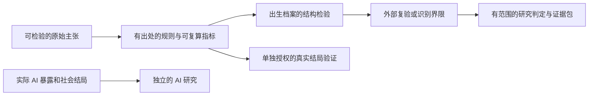

# 开放命盘研究纲领

**执行纲领 v1.0 · R49 结项后的研究方向**

本纲领规定研究终点、任务优先级和结项标准。立项冻结、复核、隐私、授权及修订程序依现行研究宪章执行。阶段按证据是否达到门槛推进，每次立项都要写明它能改变哪条判断。[研究宪章](../CONSTITUTION.zh.md) · [研究进展与证据范围](../RESEARCH_STATUS.zh.md)

## 一　终极目标

**对「年轻世代是否存在跨人群、可复现的命理断层」给出可独立复核、适用范围明确的研究判定。** 先把原说法落实到具体规则、对象、年龄或公历窗口和可被推翻的条件，再用独立出生档案检验。最后交付一份有实质结论的研究报告及可复现的证据包。每条结论写明它覆盖的规则和人群、支持或排除的效应大小、仍未分辨的原因，以及什么新证据可以改变判断。

长期科学问题是，若其中某项规则还能提出明确的现实预测，它能否在未见过的结局上超越合理基线。达到这一步需要一项独立、获授权的验证研究。关于 AI 与社会剧变的原始疑问可按同一证据原则立项，使用实际 AI 暴露、可观察的社会结局与独立的识别设计。[原始研究问题](RESEARCH_QUESTIONS.md) · [研究宪章](../CONSTITUTION.zh.md)

结项以**结论的质量和边界**验收。效应得到支持、预设量级被排除、现有资料无法区分，三种判定都可以构成完整交付。研究可在证据审计完成后结项，资料不足的科学命题仍保留「未分辨」。理由必须可核实，例如缺失字段使可行结果落在门槛两侧，或合法来源框给出的统计区间仍跨门槛。出生记录数、古籍例题数和研究轮数用于说明证据覆盖。

## 二　R49 之后的全局判断

| 关键问题 | 已得到的证据 | 剩余问题及其重要性 |
| --- | --- | --- |
| 「排不出运段」的字面含义 | R48 的 6,766 条记录在指定八字与两种紫微排法下具有连续的成年运段。古籍的起限异读可以改变宫位。 | 原传闻的首发、分母和可执行判定规则仍待确认。能证明另一规则确实溯源且会改变运段或实验判定的反例，才值得重开主线。[R48](../R48.md) |
| 四组有没有达到预定强度的共同缺段 | R45 在第 80 百分位的所检同龄及同公历窗口排除 +5 个百分点。R46 在 2009 年两组整点对照中排除 +5。R49 用 21,416 条新记录，在第 75 百分位同龄口径下得到共同峰 +2.206、主上界 +3.469 个百分点，排除 +5。 | 对这些特定档案框及冻结模型，原门槛问题已结项。较小效应、不同定义和其他地区是三个各自有条件的命题。[R45](../R45.md) · [R46](../R46.md) · [R49](../R49.md) |
| 项目指标代表什么 | 四体系评分衡量已说明的结构信号。R45 中仅凭「存在某一段连续十年无联合高分」，固定巴西参照也有 99.95% 的记录符合，因此本项目进一步检验同一窗口的共同集中。 | 「缺段」和传统用语之间的对应关系仍有待论证。四体系共享出生输入和若干历法、天文周期。最优先找出哪些有文献依据的规则差异、共同时间结构或数据误差足以改变判定。[R45 结果](../rounds/r45/RESULTS.zh.md) · [四体系实现范围](four_system_readiness.md) |
| 结果能否迁移到其他人群 | R49 是物理记录互斥的复验，部分样本仍来自同一官方登记体系。R47 对日本 148,030 次公开出生的日期与小时计数证明，符合相同计数的分钟和性别分配可使共同峰落在 +5 两侧。 | 关键缺口是可识别、可获得合规权限的同时代外部来源。巴西 1999 的合格记录地域集中，墨西哥 1999 是晚登记档案。两出生年也不足以代表两个整代。[R47](../R47.md) · [R49 来源范围](../rounds/r49/RESULTS.zh.md) |
| 能否预测现实或识别 AI 因果效应 | 命盘主线已有规则和结构检验。AI 线已有采用、就业与任务试验的分项证据，各自有观察单位和边界。 | 两个问题未来各自需要明确的现实终点、独立证据及预先规定的识别方法。独立死亡结局研究的启动权限依宪章。[宪章](../CONSTITUTION.zh.md) · [R14](../R14.md) · [R17](../R17.md) · [R24](../R24.md) |
| 证据能否脱离当前工作环境复现 | R49 已有公开登记、源档封存、原档重建、评分重跑与独立聚合复核。完整重建指南先后依赖 R10、R13、R15、R45、R46 的输入或排除键。仓库自动检查覆盖代码测试和指定发行版完整性。 | 研究者从干净环境重建这条依赖链的能力，值得以一次完整验收建立证据。公开检查、团队内独立计算、外部复现和同行评议各自记录实际完成范围。[R49 复算](../rounds/r49/REPRODUCE.md) · [计算检查](../.github/workflows/checks.yml) · [发行版检查](../.github/workflows/r9-checks.yml) |

## 三　研究层级与证据门槛

| 研究层级 | 立项前锁定 | 验收时交付 |
| --- | --- | --- |
| **原说法与规则忠实性** | 可定位的原文或明确标记为项目自定义的命题，传统版本、分歧及适用域。 | 原书、现代约定与软件取舍可逐项追溯。用有出处的正反例验证。只有与主张判定有关的异读进入主研究。 |
| **模型结构与可迁移性** | 效应量、最小关注效应、样本框、比较组、阴性对照、正向注入、主要误差、留出和停止条件。 | 发布主要结果、区间、所有预设对照和独立复算。共同历法与记录分布的影响用保留必要年龄、队列、地区或时钟结构的对照评估。登记设计须说明年龄、出生年和公历时期如何联动。 |
| **现实预测** | 获授权的、可观测的单一终点和时间窗。规则、预测条件、随访、比较基线及最小有意义的改进在看结果前冻结。 | 用真正未见的结局检验增量预测力。对概率报告校准，对判定报告漏报、误报及分母。区分已观测、失访和随访期尚未届满。结果称谓限于该终点、研究人群和证据强度。 |
| **AI 现实研究** | 一项可核的 AI 暴露、分析单位和社会结局，同期比较或反事实设计。 | 逐项区分使用、关联和可识别的因果效应。任何跨尺度的「文明」判断须另有同尺度的结局定义和独立证据。 |

四体系联合信号保留其共同输入的依赖。在新模型开发中，把当前 R49 当作已见证据。依据古籍、测量误差或共同历法提出的一个可辩护替代定义，可先作有范围的诊断。目标发现进入未用于选规则或调阈值的外部样本检验。现有 +5 个百分点保留给可比问题，其他尺度的门槛由新命题及实际意义决定并事前登记。[研究宪章](../CONSTITUTION.zh.md) · [独立数据复验与计算复现的区分](https://www.nationalacademies.org/read/25303/chapter/3)

## 四　项目架构与交付接口

状态页回答「目前能说什么」。研究轮次回答「依据在哪里」。以研究进展页作为当前入口，直接链接现行判断、适用范围与新证明。各轮保留当时的冻结方案和历史结论。[研究进展](../RESEARCH_STATUS.zh.md)

| 对象 | 最小交付 | 对下一环的保证 |
| --- | --- | --- |
| 主张与登记 | 一句话命题、现有判定、最有力的反例、会改变的决定、来源和停止条件 | 复验对象能在读数前冻结，探索结果有明确出处 |
| 数据与参照 | 权限、原档及版本、逐阶段分母、缺失及排除、物理互斥键、地理和时钟精度、权重、固定参照的重建路径 | 换环境后可取回同一资料，换来源时可说明人群和观察条件改变多少 |
| 规则与计算 | 带原典或技术出处的版本，明确输入、参数、年龄网格、例外、禁用域和可运行的重建步骤 | 同输入可重跑。统计结论始终能定位回具体模型和参照 |
| 分析与复核 | 聚合结果、误差范围、对照、失败记录、独立算术或复现收据、代码与公开落点 | 第三方能判断哪些被重算、哪些用了共同输入，以及哪些实证仍欠缺 |
| 结项与维护 | 当前判定及范围、覆盖的反例、开放问题、重开条件，链接版本化证据 | 新轮次只有在出现可改变判断的证据时才进入执行 |

工程上先用 **R49 作一个参考发行版**。验收路径从干净检出开始，按文档取得或按权限恢复输入，核对固定参照与样本封存，并在发布的数值容差内重现主上界和判定。遇到受限环节，记明取得途径或可复核的替代证据。首次遇到的问题优先修复入口、依赖或来源凭据。只有能解除具体复现障碍、避免多轮证据漂移，或修复会改变判断的共同缺陷，才抽取共享代码。受影响的冻结结果需回归验证。各轮独有的排除键或规则留在相应版本。[R49 复算步骤](../rounds/r49/REPRODUCE.md)

## 五　下一步的排序

1. **先做外部复验的可行性判定。** 将巴西和墨西哥已有结果固定为比较基线。从 R47 已见候选中优先核对最接近所需字段的一个同时代来源。日本围产登记是待核候选，R47 已记录 2001–2009 年的临床二次使用。实际研究版的分钟粒度、出生发生地和对本用途的许可均需独立证据。若只有 2009 年符合条件，先判断该出生年的迁移问题。若东亚路径无法达标，可检验另一可比地区，东亚适用范围继续保留为未分辨。[候选来源及证据缺口](../rounds/r47/SOURCES.zh.md) · [围产登记二次研究条件](https://web.hosp.kanazawa-u.ac.jp/other/doc/sankafujinka_20250325.pdf)
2. **让下一份数据检验一个实质分歧。** 冻结 R49 可比口径作为基准。先问共同历法、记录取整或一个有史料依据的排法分歧能否改变 +5 门槛的判断。按反例的影响选最少的预设对照，明确在什么结果下修订模型或缩小人群范围。若可辩护的规则版本给出不同判定，发布各版本的结论，并把差异列作研究发现。跨地区、跨规则和跨年龄分别登记各自能解释的命题。
3. **用一次冷启动复现验证交付体系。** 选择 R49 的完整主结果，要求复现者能够跟随公开入口完成或明确定位受限环节。把确认可修、可重复的阻碍纳入维护。前两步需要的证据能由现有流程产出时，优先把算力和审查用在实证检验上。
4. **将现实验证留给可独立立项的问题。** 若项目负责人另行授权，优先选择一项可观测、可完整跟踪、具有公允基础模型的现实终点。预测的增量表现经外部数据检验后，再决定是否扩大。AI 线只有在一个明确的现实问题有合格的比较设计时进入新轮。[宪章授权和验证规则](../CONSTITUTION.zh.md) · [现实预测报告可参考的 TRIPOD+AI](https://pubmed.ncbi.nlm.nih.gov/38626948/)

## 六　下一轮的验收书

**下一项交付是外部出生档案的立项结论。** 核心问题是，能否在巴西、墨西哥以外，使用与旧样本互斥的同时代来源，对同一量级的共同缺段作出有判别力的检验。优先沿用 1999、2009 两出生年、巴西 2006 固定参照及已登记的定义。其他年份或更窄范围可形成单独写明的人群命题。

外部组应先报告自身效应及区间。只有一个合格出生年时，可把 R49 的 34 岁起点作为由既有研究提出的具体复验窗口，并另报按预设校正的全年龄曲线。有多个合格外部队列时，先登记新的跨组比较集合和共同峰定义。把外部组直接加进旧四组取最小值，会机械地降低或保持共同峰。迁移判断应来自新来源自身或事前独立定义的外部比较。

| 验收项 | 有效证据 |
| --- | --- |
| 可用来源 | 实际发生年、发布和研究资格、同一记录的出生日期、时分、登记性别和可定位发生地。经证据支持的发生地近似须说明。全量覆盖与选择偏差单列。 |
| 足以改变判断 | 在看目标结果前写清抽样框、可达到的精度、可能跨越门槛的缺失或误差、固定模型和比较。若只能取得聚合，须给出有来源的可行界限及条件，另计足以影响推断的误差。 |
| 立项决定 | 资料合格且比较有判别力，登记并检验。只有部分组或边际计数，交付对应的窄命题或识别界限。仍欠关键字段、授权或判别力，记录已核的证据和重开条件，将该问题置为未分辨。外部区间完全高于门槛、完全低于门槛或与门槛重叠时，分别判断支持、排除和未分辨。若外部判断与既有证据不同，先核钟点、地点和入样规则，再决定如何解释差异。 |
| 负责人验收 | 执行者提交来源、判断及分歧记录。复核者可沿证据重做关键判断。负责人只需验收结论及适用范围，并决定涉及新权限或现实终点的范围变化。 |

## 七　工作何时停止，何时重开

每个任务立项时写明两句话。**目前结论是什么。完成什么证据后会改哪一句。** 学术增量来自新增的独立来源、可信的反例、足以变化判定的误差界，或者从源档到结论的关键复现障碍得到解决。缺乏这些增量的同源扩样、精度微调、传统条目扩编和大规模重构留在后备记录。

已排除或得到支持的命题保留原统计口径及适用范围。只有新增独立来源可能改变外推、出现能动摇规则或测量的反例、发现源档或实现错误、或者获得足以缩窄未决范围的新事实时，才重开相应判断。若多个方法给出不同判定，先核对它们是否共享数据、估计对象和选择校正，再按事前顺序作正式判断。原结果与更正均可追溯。[R46 两种上界的实例](../rounds/r49/R46_DIFFERENCE.zh.md)

项目阶段最终交付一份综合研究报告、可还原的证据包和明确的未决清单。报告列出支持或排除的量级、适用来源和规则，以及仍需怎样的资料才能继续。对成熟主问题，以一项合格的外部复验或足以证明现有资料无法判定的证据结案，同时保留将来可重开的条件。事前登记、外部复核和期刊注册报告按实际完成的程序署名。[研究宪章](../CONSTITUTION.zh.md) · [注册报告的审查流程](https://www.cos.io/initiatives/registered-reports)
