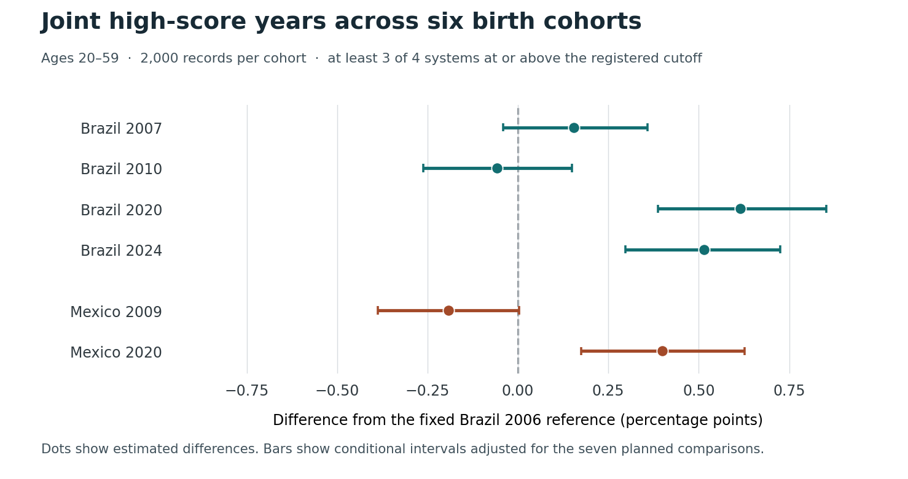

# R10 independent replay results

**27 November 2026.** Joint high-score years were more frequent than in the fixed Brazil 2006 reference for Brazil 2020, Brazil 2024 and Mexico 2020. Their differences were **+0.615, +0.514 and +0.399 percentage points**, respectively. The seven-slot adjusted intervals for all three lie above zero. The adjusted intervals for Brazil 2007, Brazil 2010 and Mexico 2009 include zero. All six upper limits fall below the prespecified **+1 percentage point** resolution target.

## Six contrasts against the same reference

The joint high-score rate was **3.214943%** in the 2,000 Brazil 2006 reference records. Each system was calibrated to the weighted reference score distribution within completed-age bands 20–29, 30–39, 40–49 and 50–59. A modeled year qualified when at least three systems reached the reference's 80th percentile. The joint rate averages each record's proportion of qualifying years across its 40-year trajectory using the source design weights.

The last three columns are in **percentage points**. The adjusted interval conditions on the fixed empirical reference. The final column gives the empirical 2.5th and 97.5th percentiles across 999 shared-reference refits as a sensitivity check.

| Birth cohort | Joint high-score years | Difference | Seven-slot adjusted interval | Reference-refit sensitivity range |
|---|---:|---:|---:|---:|
| Brazil 2007 | 3.370% | +0.155 | [−0.041, +0.359] | [−0.068, +0.350] |
| Brazil 2010 | 3.158% | −0.057 | [−0.262, +0.150] | [−0.267, +0.163] |
| Brazil 2020 | 3.830% | +0.615 | [+0.388, +0.852] | [+0.393, +0.832] |
| Brazil 2024 | 3.729% | +0.514 | [+0.298, +0.726] | [+0.303, +0.725] |
| Mexico 2009 | 3.023% | −0.192 | [−0.387, +0.003] | [−0.402, +0.009] |
| Mexico 2020 | 3.614% | +0.399 | [+0.175, +0.627] | [+0.193, +0.642] |

Each main interval uses 9,999 whole-record resamples within occurrence-state-by-sex strata and a finite-population correction. The registered additional-country slot was unavailable and remains in the seven-slot family. The Bonferroni adjustment for the 5% family level gives a nominal 99.2857% interval per comparison. The export also includes the individual 95% intervals and additional numerical precision. [Cohort table](results/cohort_contrasts.csv)

## The four systems

The table shows the mean weighted mid-CDF score for each system relative to the same-age Brazil 2006 reference, which has a mean of 0.5 in each column. The joint rate measures systems crossing their thresholds in the same modeled year. For example, Brazil 2020 had a mean percentile of 0.5067 for Bazi and 0.4907 for Western astrology. It had the largest joint-rate contrast despite differing directions of mean change across systems.

| Birth cohort | Bazi | Ziwei Doushu | Qizheng Siyu | Western astrology |
|---|---:|---:|---:|---:|
| Brazil 2006 reference | 0.5000 | 0.5000 | 0.5000 | 0.5000 |
| Brazil 2007 | 0.5015 | 0.4982 | 0.4961 | 0.5007 |
| Brazil 2010 | 0.5037 | 0.5027 | 0.4958 | 0.4971 |
| Brazil 2020 | 0.5067 | 0.4997 | 0.4982 | 0.4907 |
| Brazil 2024 | 0.5001 | 0.4977 | 0.5001 | 0.4959 |
| Mexico 2009 | 0.5041 | 0.4885 | 0.4990 | 0.4976 |
| Mexico 2020 | 0.5055 | 0.4947 | 0.4989 | 0.4929 |

In the descriptive 50–59 age band, the three younger cohorts' joint rates were 6.680%, 6.073% and 6.123%, compared with 4.819% in Brazil 2006. These are computed age patterns. The full output gives all four age bands, the ages 20–39 secondary window, raw system means, and calendar-year denominators for 2026–2070. The Brazil 2024 cohort first enters the registered adult window in 2044/45. [Raw and reference-transformed system means](results/four_system_means.csv) · [Full statistical output](results/structural_comparison.json)

## Source recovery and verification

Six samples of 2,000 original birth records produced complete ages 20–59 in all four models. That is 12,000 records, 480,000 modeled record-years and 1,920,000 finite scores. The separate reference comprised 2,000 Brazil 2006 records recovered from the byte-identical historical R8 profile archive. The registration was verified on GitHub at 07:33 UTC, scoring started at 07:34 UTC, and scoring finished at 08:00 UTC. [Prescoring registration](REGISTRATION.md) · [Completion receipt](results/aggregation_ready.json) · [Reference verification](../recovery/reference_anchor.json)

**The two original Mexican sampling metadata files were not recovered.** The actual model inputs for all six cohorts match their historical digests. Mexico's selected physical records, source identities, ranks, 106 stratum totals and quotas, and each record's inclusion probability and weight were independently reconstructed from official registration archives. The 2009 cohort uses municipal-seat reference points in 26 states. The 2020 cohort uses matched census localities in 27 states. Both cover registrations in the birth year and the following year. All four Brazilian historical metadata files matched. This release identifies the analysis as an independent replay on the original records. [Design and source audit](../recovery/input_and_design_receipt.json)

A separate statistical implementation reproduced all 399 main checks in the same Linux environment that reproduced the historical R8 scores, including the 9,999 resamples and adjusted intervals in every cohort. A second algorithm replayed all 999 shared-reference refits, and a reverse ordering calculation cross-checked descriptive statistics. The lowest and highest sampling ranks from each cohort were scored again in fresh Linux processes. All 12 complete profiles matched. These are internal computational checks. [Primary verification](results/independent_primary_review.json) · [Sensitivity verification](results/independent_refit_review.json) · [Descriptive verification](results/independent_descriptive_review.json) · [Fresh-process check](results/fresh_worker_review.json)

The macOS replay agreed on all point estimates. Some seeded primary bootstrap interval endpoints differed in four cohorts, with a maximum difference of 0.0117 percentage points. The original Linux intervals are retained alongside the two environments' reports and a diagnostic. The interval conclusions relative to zero and +1 percentage point were the same for all six cohorts. [Platform diagnostic](verification/PLATFORM.md) · [Original macOS review output](results/macos_primary_replay.json)

## Interpretation

Every selected record had a four-system output at every registered adult age. Three younger source-year cohorts showed a measurable increase in modeled joint high-score years. Coverage is limited to selected years and administrative sources in two countries. Cohort, geography, registration coverage and shared calendar or astronomical cycles can all influence the contrasts. The intervals address sampling uncertainty conditional on the design. Source selection, clock and location error, traditional validity and global generalization require different evidence. The observed events here are births. The study did not observe deaths, disasters, individual life outcomes or exposure to AI, and it cannot attribute real events to these modeled differences. [Implementation boundaries](../../../docs/four_system_readiness.md) · [中文报告](RESULTS.zh.md)
