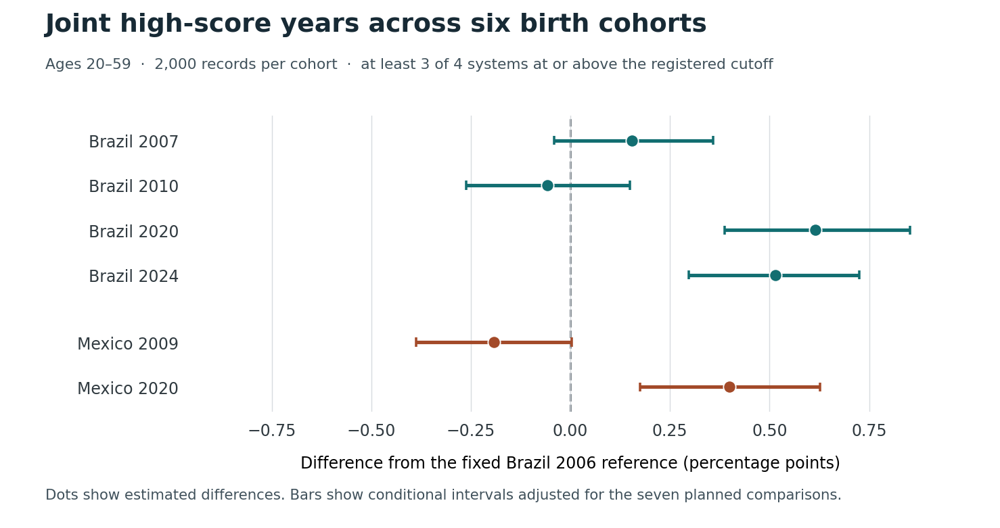

# R10 独立复算结果

**2026 年 11 月 27 日。** 在登记的六个出生队列中，巴西 2020、巴西 2024 和墨西哥 2020 三组的联合高分年度比例高于巴西 2006 年参照，三组差值分别为 **+0.615、+0.514 和 +0.399 个百分点**。三者在七项比较校正后的区间均高于零。巴西 2007、巴西 2010 和墨西哥 2009 的校正区间均包含零。六组区间的上端全部低于预设的 **+1 个百分点**。这个量级是研究的分辨目标。

## 同一个参照下的六组差值

巴西 2006 年的 2,000 条参照记录给出的联合高分年度比例为 **3.214943%**。对每个体系，先按 20–29、30–39、40–49、50–59 岁四个年龄段，用参照组的抽样权重将分数换成参照分位。某条记录在某一年龄若有至少三个体系达到第 80 百分位，就计作一个联合高分年度。先算每条记录 40 年中这类年份的比例，再按各自来源的抽样权重汇总。

表中后三列均以**百分点**为单位。校正区间以固定参照计算。最后一列取 999 次共同重新拟合参照的第 2.5 和 97.5 百分位，仅用于检查对参照选择的敏感性。

| 出生队列 | 联合高分年度占比 | 相对参照差值 | 七项比较校正区间 | 重新拟合参照的敏感范围 |
|---|---:|---:|---:|---:|
| 巴西 2007 | 3.370% | +0.155 | [−0.041, +0.359] | [−0.068, +0.350] |
| 巴西 2010 | 3.158% | −0.057 | [−0.262, +0.150] | [−0.267, +0.163] |
| 巴西 2020 | 3.830% | +0.615 | [+0.388, +0.852] | [+0.393, +0.832] |
| 巴西 2024 | 3.729% | +0.514 | [+0.298, +0.726] | [+0.303, +0.725] |
| 墨西哥 2009 | 3.023% | −0.192 | [−0.387, +0.003] | [−0.402, +0.009] |
| 墨西哥 2020 | 3.614% | +0.399 | [+0.175, +0.627] | [+0.193, +0.642] |

主结果每组使用 9,999 次州内按性别分层、以整条出生记录为单位的重抽样，并作有限总体修正。预留的第七个国家来源没有取得合格资料，仍计入七项比较。按 5% 家族错误率作 Bonferroni 校正后，每项区间的名义覆盖率为 99.2857%。未校正的 95% 区间及全精度差值可在表格中查阅。[六组数值表](results/cohort_contrasts.csv)

## 四个体系提供了什么信息

下表是各体系相对于巴西 2006 同年龄段参照的**平均分位**，参照各列的均值为 0.5。联合高分比例关心几个体系是否在同一年越过阈值。以巴西 2020 为例，其八字平均分位为 0.5067，西方占星为 0.4907，仍然出现了本轮最大的联合差值。可以观察到共同越过阈值的频率上升，即便各体系均值的变动方向不同。

| 出生队列 | 八字 | 紫微斗数 | 七政四余 | 西方占星 |
|---|---:|---:|---:|---:|
| 巴西 2006 参照 | 0.5000 | 0.5000 | 0.5000 | 0.5000 |
| 巴西 2007 | 0.5015 | 0.4982 | 0.4961 | 0.5007 |
| 巴西 2010 | 0.5037 | 0.5027 | 0.4958 | 0.4971 |
| 巴西 2020 | 0.5067 | 0.4997 | 0.4982 | 0.4907 |
| 巴西 2024 | 0.5001 | 0.4977 | 0.5001 | 0.4959 |
| 墨西哥 2009 | 0.5041 | 0.4885 | 0.4990 | 0.4976 |
| 墨西哥 2020 | 0.5055 | 0.4947 | 0.4989 | 0.4929 |

按年龄描述，三个较年轻来源在 50–59 岁的联合高分年度比例分别为 6.680%、6.073% 和 6.123%，巴西 2006 年同年龄段为 4.819%。这些是模型生成的年龄分布。其他年龄段、20–39 岁子窗口、四体系原始均值以及 2026–2070 每个日历年的有效分母均已公开。巴西 2024 队列到 2044/45 年才进入预设成年窗口。[体系均值与差值](results/four_system_means.csv) · [完整统计结果](results/structural_comparison.json)

## 来源、恢复与复核

六组每组 2,000 条，共 12,000 条原始出生记录。四套模型为每条记录完整算出 20–59 岁，共 480,000 个记录年、1,920,000 个有限分数。另有巴西 2006 年 2,000 条参照记录，其原始 R8 评分文件已逐字节复现。预登记于北京时间 15:33 在 GitHub 可核验，复算于 15:34 启动，16:00 完成评分。[评分前登记](REGISTRATION.md) · [完成回执](results/aggregation_ready.json) · [参照核验](../recovery/reference_anchor.json)

**墨西哥 2009 和墨西哥 2020 的两份原始抽样说明未找回。** 六组实际评分输入都与原轮封存的文件逐字节一致。墨西哥两组的入选行、来源、排名、106 个分层的样本数和总体数、每条记录的抽中概率与权重，已用官方登记档独立重建并核查。2009 年组使用 26 个州的市镇驻地近似出生地点，2020 年组使用 27 个州的普查地点。两组各覆盖本年和次年的登记。巴西四组的原抽样元数据均已验真。这次发布的身份是使用原记录的独立复算。[六组来源和权重核验](../recovery/input_and_design_receipt.json)

独立统计实现在复现历史 R8 参照的同一套 Linux 环境中通过全部 399 项主结果核对，包括每组 9,999 次主重抽样及其校正区间。另一套实现复算了全部 999 次共同参照重拟合。描述统计还经过反向排序的交叉核对。另将每组抽样排名首尾的两条记录放进全新计算进程重算，12 份完整轨迹均逐项相同。这些复核属于项目内部计算验证。[主结果复核](results/independent_primary_review.json) · [参照敏感性复核](results/independent_refit_review.json) · [描述统计复核](results/independent_descriptive_review.json) · [独立进程重算](results/fresh_worker_review.json)

跨平台重放保留了一项差异。macOS 上复核时，六组点估计一致，四组的部分主重抽样区间端点未能按同一种子逐数复现，最大端点差为 0.0117 个百分点。主计算所用 Linux 环境的原始区间、两套环境的复核回执及诊断均保留。六组校正区间相对于零与 +1 个百分点的位置判断相同。[平台差异核查](verification/PLATFORM.md) · [macOS 原始回执](results/macos_primary_replay.json)

## 对“断层”的回答

每一条记录在预设的 40 个成年年龄上都有四体系输出。三组较年轻队列显示了幅度可量化的联合高分上升。资料只覆盖两个国家的特定登记样本，队列年份、地区、登记覆盖、历法和天文周期都可能影响比较。区间刻画抽样误差，来源选择、时钟与地点误差、传统规则的有效性以及全球代表性各有独立的不确定性。研究观测了出生记录，成年轨迹由模型生成。本轮没有追踪死亡、灾害、个人运势或 AI 暴露，无法据此判断现实世界或整代人会发生何种事件。[四体系实现范围](../../../docs/four_system_readiness.md) · [English report](RESULTS.md)
