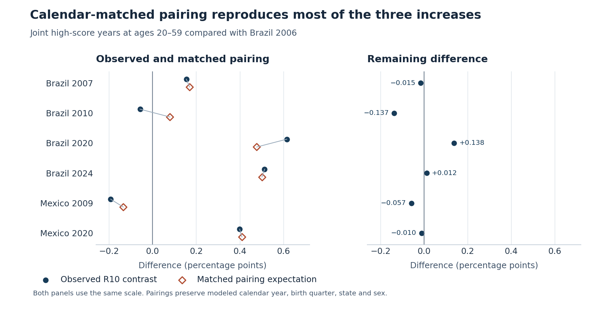

# R11 · Calendar-matched controls for four-system alignment

**27 November 2026.** Pairing trajectories within birth quarter, modeled calendar year, state and sex reproduced most of the R10 increase in three younger cohorts. The remaining differences from Brazil 2006 were **+0.138 percentage points** for Brazil 2020, **+0.012** for Brazil 2024 and **−0.010** for Mexico 2020. The smallest Holm-adjusted p value across the seven pairing tests was **0.0686**, above the registered 0.05 family level. [Registration](REGISTRATION.md) · [中文结果](RESULTS.zh.md)

The analysis uses the seven samples already scored in R10, including 2,000 Brazil 2006 reference records and six targets of 2,000 records each. Each record contributes a complete ages 20–59 trajectory. A joint high-score year has at least three of four systems at or above the fixed reference's 80th percentile within its age band. Within each cohort's state, sex, birth-quarter and age-20 calendar-year cells, pair the whole trajectories of three systems independently while fixing Bazi's order. This preserves each system's age-specific cell marginals, its within-profile age dependence and the original source design weights. Exact marginal products give the expected joint rate.

| Cohort | Original difference (pp) | Matched pairing difference (pp) | Remaining difference (pp) |
|---|---:|---:|---:|
| Brazil 2007 | +0.155 | +0.170 | −0.015 |
| Brazil 2010 | −0.057 | +0.080 | −0.137 |
| Brazil 2020 | +0.615 | +0.478 | +0.138 |
| Brazil 2024 | +0.514 | +0.501 | +0.012 |
| Mexico 2009 | −0.192 | −0.135 | −0.057 |
| Mexico 2020 | +0.399 | +0.410 | −0.010 |

Brazil 2020's remainder was +0.141 with state, sex and calendar-year matching, +0.138 with quarter and +0.105 with month. The other two younger cohorts' absolute remainders were all below 0.031 percentage points across these definitions. A weight share of 98.91%–99.47% could be shuffled among at least two records with quarter matching. A monthly cell has fewer available donors. The aggregate results include coverage, the conditional permutation ranges and unadjusted and adjusted p values for all seven cohorts. [Numerical output](results/calendar_controls.json)

The seven two-sided tests use 4,999 permutations per cohort and Holm adjustment. They concern the departure from within-cell trajectory exchangeability for the supplied inputs. The cross-cohort remainders describe the fitted decomposition. Finer clocks, dates and locations, dependencies among models, and source selection can still contribute. The decomposition does not assign a causal contribution to calendar features. This was a retrospective analysis of previously studied cohorts. Replication beyond these samples requires a held-out cohort and a prespecified endpoint. Observed life events and AI exposure require their own independent evidence. [R10 sampling contrasts](../r10/independent_replay/RESULTS.md)

An exhaustive synthetic case verified the exact expectation. In 120 synthetic season-only panels, 2 tests rejected at nominal 0.05. When the expected within-record excess was raised by 1 percentage point, 115/120 rejected at 0.05/7. An alternate implementation reproduced all 2,240,000 threshold flags and all 34,993 permutations. This was internal computational verification with shared inputs and seeds. Main analyses on macOS arm64 and Linux x86-64 produced byte-identical results. The two original Mexican design documents remain unrecovered. The analysis uses the verified R10 reconstruction. [Calibration](results/calibration.json) · [Verification](results/review.json) · [Platform replay](results/platform_replay.json) · [Data recovery](../r10/recovery/README.md)

A separate birth-field audit found 145,522 eligible Mexico 2020 records registered in 2022–2025. Using the same two-registration-year window, Mexico 2023 has 1,244,893 eligible records and is a candidate for a fresh whole-cohort study. The audit counted source records before selection or scoring. [Source audit](SOURCES.zh.md) · [Machine-readable counts](results/mexico_registration_sources.json)
