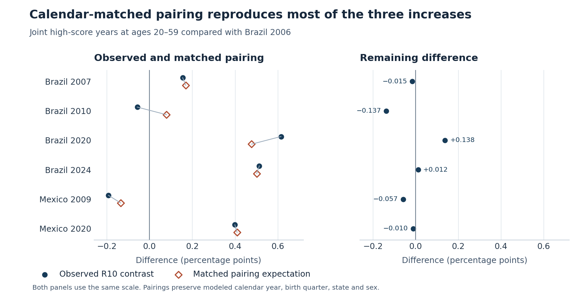

# R11 · 四体系联合高分的历法对照

**2026 年 11 月 27 日。** 保留共同历年、出生季度、州和性别后，同组重排重现了巴西 2020、巴西 2024 和墨西哥 2020 相对参照上移的大部分。巴西 2024 与墨西哥 2020 的剩余差值接近零。巴西 2020 在三种匹配口径下均保留小幅正差值，季度主口径为 **+0.138 个百分点**。七组配对检验经校正后的最小 p 值为 **0.0686**，高于登记的 0.05 家族阈值。[既有 R10 结果](../../R10.md) · [R11 预先登记](REGISTRATION.md)

## 三组上移能重现多少

七组各 2,000 条，合计 14,000 条已在 R10 使用的来源记录，覆盖 560,000 个建模记录年。原配对沿用 R10 的固定参照、四体系第 80 百分位阈值、三体系同时高分口径及抽样权重。每个队列内，把同州、同性别、同出生季度且在同一公历年达到模型年龄 20 的记录放在同一组，再分别重排紫微斗数、七政四余和西方占星各自的 40 年轨迹，八字轨迹留在原位。各体系在组内每一年有多少高分，以及同一体系的跨年龄变化，都保留下来。

巴西 2006 的原联合高分率为 3.214943%，按季度重排的期望为 3.202010%。下表三列均为相对于该参照组的差值，单位是百分点。剩余差值等于原差值减去重排期望差值。

| 出生队列 | 原差值 | 保留条件的重排期望差值 | 剩余差值 |
|---|---:|---:|---:|
| 巴西 2007 | +0.155 | +0.170 | −0.015 |
| 巴西 2010 | −0.057 | +0.080 | −0.137 |
| 巴西 2020 | +0.615 | +0.478 | **+0.138** |
| 巴西 2024 | +0.514 | +0.501 | +0.012 |
| 墨西哥 2009 | −0.192 | −0.135 | −0.057 |
| 墨西哥 2020 | +0.399 | +0.410 | −0.010 |

巴西 2020 的剩余差值在只匹配州、性别和历年时为 +0.141 个百分点，加上出生季度为 +0.138，改用出生月为 +0.105。另两组在这三个口径下的剩余差值绝对值均低于 0.031 个百分点。季度匹配下，七组中每组都有 98.91%–99.47% 的抽样权重落在至少两条记录的配对组，至少五条记录的比例为 88.99%–92.42%。月度细分后，后者降至 56.41%–63.02%。可配对人数少时，重排较容易保留来自同一记录的组合，月度分解须连同这些分母理解。[全部配对口径和有效覆盖](results/calendar_controls.json)

## 配对检验及其适用范围

每组独立重排 4,999 次，检验原轨迹的同年重合偏离其本组重排期望的幅度。配对范围是条件在已选记录和各体系边际上的百分位数。跨队列剩余差值是描述量。R10 原条件抽样区间的估计对象是原始差值，仍见 R10 报告。

| 出生队列 | 原联合高分率 | 季度重排期望 | 95% 重排范围 | Holm 校正 p |
|---|---:|---:|---:|---:|
| 巴西 2006 | 3.215% | 3.202% | 3.093%–3.309% | 1.0000 |
| 巴西 2007 | 3.370% | 3.372% | 3.267%–3.482% | 1.0000 |
| 巴西 2010 | 3.158% | 3.282% | 3.172%–3.391% | 0.1728 |
| 巴西 2020 | 3.830% | 3.680% | 3.564%–3.793% | 0.0686 |
| 巴西 2024 | 3.729% | 3.703% | 3.587%–3.816% | 1.0000 |
| 墨西哥 2009 | 3.023% | 3.067% | 2.959%–3.174% | 1.0000 |
| 墨西哥 2020 | 3.614% | 3.612% | 3.501%–3.727% | 1.0000 |

这组结果说明，保留合理共同条件下各体系自己的高分分布，已经能重现很大一部分原差异。这个分解综合了历年、季节、州和性别，现有设计无法从中识别各项的因果贡献。具体出生日、时钟、地点、排盘规则、出生年代与成年历年的关系，以及登记来源的选择仍可能影响差值。复用同一批已知队列属于回顾性诊断。将巴西 2020 的小幅剩余解释为可推广的结构差异，需要在未分析过的整出生年份或地区上用冻结标准复核。现实中的断运或 AI 影响需要独立定义并观测结局。[R10 条件抽样结果](../r10/independent_replay/RESULTS.zh.md)

## 可核验记录

公开登记和代码先于本轮结果计算。合成数据的 216 种小例置换逐个对上解析期望。120 次只含共同季节和年龄规律的试验有 2 次在未经校正的 0.05 阈值下拒绝。注入期望为 +1 个百分点的同记录重合后，按更严格的 0.05/7 阈值检出 115/120。数值评估限于该合成生成器。[合成验证回执](results/calibration.json)

另一条计算路径重做了全部 **224 万个阈值标记、34,993 次重排**以及期望、区间、尾次数和差值。它复用输入和随机种子，采用独立排序阈值、概率和计数实现，属于项目内部复核。主分析在 macOS arm64 与 Linux x86-64 的输出逐字节一致。墨西哥两组沿用 R10 的官方来源恢复设计，两份历史抽样说明仍缺失。公开结果只有队列级汇总和校验值。[内部复核回执](results/review.json) · [跨平台复现](results/platform_replay.json) · [R10 来源恢复](../r10/recovery/README.md) · [英文版](RESULTS.md)

本轮还实查了墨西哥 2022–2025 年登记档。2020 年出生者新增 145,522 条合格晚登记记录。未抽样评分的墨西哥 2023 年在同样的两年登记窗内有 1,244,893 条合格记录，具备下一次整出生年留出验证的资料条件。[登记核验与候选资料](SOURCES.zh.md)
