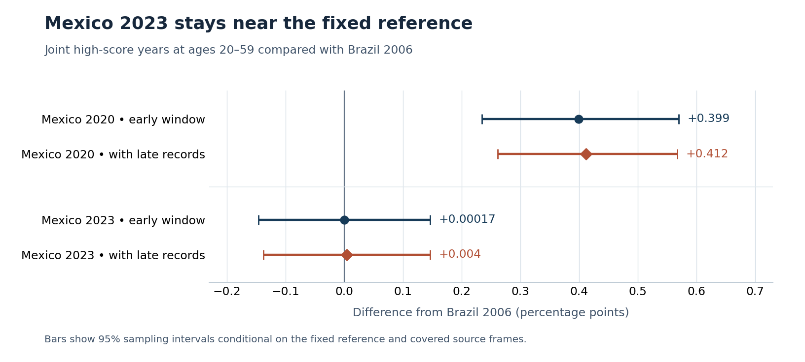

# R12 · Mexico 2023 whole-year holdout

**27 November 2026.** The held-out Mexico 2023 joint high-score rate was **3.215116%**, compared with **3.214943%** in the fixed Brazil 2006 reference. The difference was **+0.00017 percentage points**, with a conditional 95% interval of **−0.146 to +0.146**. The interval crosses zero and its upper limit is below the registered +1 percentage point resolution target. [Registration](REGISTRATION.md) · [中文结果](RESULTS.zh.md)

The primary sample was 2,000 records from 1,244,893 eligible 2023 births registered in 2023–2024. The frozen calculation identifies a modeled year as jointly high when at least three systems reach the fixed Brazil 2006 weighted 80th percentile in their age band. It covers completed ages 20–59. The sole primary interval uses 9,999 whole-record resamples within state-by-sex strata with the original finite-population factor. It conditions on the empirical reference and covered source frame. [Sample seal](INPUT_SEAL.json) · [Full results](results/holdout.json)

With R11 quarter matching, the difference expected from independently pairing whole trajectories within state, sex and calendar-year cells was **+0.091 percentage points**. The remainder was **−0.091**. The within-cohort pairing p value was 0.164. The registered replication rule required the raw interval to lie above zero before judging whether matched pairing reproduced at least half the observed point contrast. This rule was unmet. Calendar-only and monthly versions are in the complete output.

| Mexico birth cohort | Eligible late registrations | Expanded-frame contrast (pp, 95% interval) | Change from early window (pp, 95% interval) |
|---|---:|---:|---:|
| 2020 | 145,522 | +0.412 [+0.261, +0.567] | +0.012 [−0.017, +0.041] |
| 2023 | 39,107 | +0.004 [−0.138, +0.146] | +0.004 [−0.004, +0.012] |

Each late window used a new sample of 1,000. The expansion preserves the eligible-frame shares of early and late registrations. Matching the known early result for Mexico 2020 uses the verified R10 recovery design. The two historical Mexican metadata files still remain unrecovered. [Source audit](../r11/SOURCES.zh.md) · [R10 recovery](../r10/recovery/README.md)

The three new samples produced 4,000 complete trajectories and 640,000 scores. A separate arithmetic path matched 97 aggregate fields, 39,996 bootstrap draws and 4,999 pairing permutations. Six complete trajectories reproduced in fresh workers. On the same score inputs, the macOS and Linux aggregate files were byte-identical. This is internal computational review. The analysis addresses model structure in the named source cohorts. A new population is needed to establish geographic transfer, and observed events require independent outcome data. [Numeric verification](results/review.json) · [Platforms](results/platform_replay.json) · [Reproduction](REPRODUCE.md)
