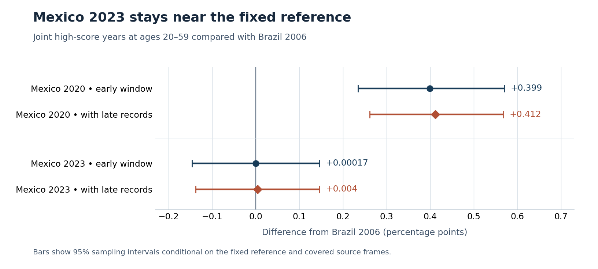

# R12 · 墨西哥 2023 整出生年留出结果

**2026 年 11 月 27 日。** 墨西哥 2023 年留出组的联合高分率为 **3.215116%**，巴西 2006 年固定参照为 **3.214943%**。差值为 **+0.00017 个百分点**，95% 条件区间为 **−0.146 至 +0.146 个百分点**。这一未分析过的墨西哥出生年没有复现 R10 的正向上移。区间上端也低于登记的 +1 个百分点量级。补入晚登记，2023 年估计仍接近参照，墨西哥 2020 年此前观察到的上移继续出现在扩展框中。[评分前登记](REGISTRATION.md) · [完整机器可读结果](results/holdout.json)

## 唯一主要比较

从 2023–2024 年 INEGI 登记档中 **1,244,893 条**符合原口径的 2023 年出生记录里，按出生州和性别抽取 2,000 条。用冻结的八字、紫微斗数、七政四余和西方占星算法计算 20–59 岁各年。三个或以上体系在同一建模年龄达到巴西 2006 年同年龄段参照的第 80 百分位，即为联合高分年度。区间由层内对整条记录做 9,999 次有限总体校正重抽样得到。它以参照和模型为给定，对应可解析时地的受限登记框。四体系平均参照分位分别是 0.50475、0.49580、0.49961 和 0.49883。[样本封存](INPUT_SEAL.json) · [模型口径](../r10/independent_replay/RESULTS.zh.md)

## R11 的匹配结果在新队列中怎样表现

保留八字轨迹原顺序，在同州、同性别、同一成年历年和相同出生季节的组内，分别重排另外三套体系的整条轨迹。季度主口径下，99.55% 的抽样权重落在至少两条记录的配对组。各列均为相对巴西 2006 年的差值或分解量，单位是百分点。

| 保留条件 | 原差值 | 重排期望差值 | 剩余差值 |
|---|---:|---:|---:|
| 历年、州和性别 | +0.00017 | +0.120 | −0.120 |
| 再匹配出生季度（主口径） | +0.00017 | +0.091 | −0.091 |
| 改用出生月份 | +0.00017 | +0.044 | −0.044 |

2023 年的实际差值接近零。重排预期的正差和剩余负差大小相近。新队列的季度组内配对检验 p 值为 0.164。登记的组合复现判据要求主要差值区间全在零以上，再检查重排能否重现至少一半。因此这个组合判据没有达到。出生月份匹配的配对组更小，精细控制仍可能受到有限候选人数的影响。这里的组内配对检验和跨队列抽样区间回答不同问题。[R11 配对规则](../r11/REGISTRATION.md) · [三种口径的分母和结果](results/holdout.json)

## 补入晚登记改变了多少

两年各新增评分 1,000 条合格晚登记记录。墨西哥 2020 年使用 R10 的 2,000 条早登记评分，加入在 2022–2025 年登记的合格框。墨西哥 2023 年补入 2025 年的登记档。合并时按各窗口的合格总体数量加权，区间重抽早、晚两个窗口。变动和差值的单位均是百分点。

| 出生年 | 合格晚登记数（占扩展框） | 早登记联合高分率 | 晚登记联合高分率 | 补入后相对参照的差值（95% 区间） | 补入使估计变动（95% 区间） |
|---|---:|---:|---:|---:|---:|
| 墨西哥 2020 | 145,522（9.60%） | 3.614% | 3.741% | +0.412 ［+0.261，+0.567］ | +0.012 ［−0.017，+0.041］ |
| 墨西哥 2023 | 39,107（3.05%） | 3.215% | 3.339% | +0.004 ［−0.138，+0.146］ | +0.004 ［−0.004，+0.012］ |

在两个出生年，纳入目前可观察且合格的晚登记只小幅改变了估计。墨西哥 2020 年的上移仍在，2023 年的条件区间仍跨零。该敏感性覆盖至 2025 年登记档，范围为地点和时刻都通过核验的已登记出生记录。墨西哥 2020 年早登记组沿用 R10 经核验的恢复权重，两份旧墨西哥抽样说明仍未找回。[晚登记数据审计](../r11/SOURCES.zh.md) · [R10 恢复说明](../r10/recovery/README.md)

## 复核和解释

2023 年留出轮次共新增 **4,000 条**完整来源记录，包括两组晚登记样本，合计 **160,000 个记录年、640,000 个分数**。所有样本在评分前经两条选样路径核对。替代统计实现复核 97 项，重放 39,996 次分层重抽样和 4,999 次配对置换。另在六个全新进程重算三组抽样排名首尾的轨迹，结果全同。对相同已封存分数，macOS 与 Linux 的汇总文件逐字节一致。[评分完整性](results/aggregation_ready.json) · [统计核对](results/review.json) · [新进程复算](results/fresh_workers.json) · [平台核验](results/platform_replay.json)

这次留出验证把先前的上移发现限定在具体出生队列。年龄、出生年和成年历年在这项设计中仍相互关联，计算也依赖同一套时地近似和四体系模型。下一步的关键是核验另一国家有真实出生钟点的独立队列，再检验结果能否跨来源复现。现实中的断层或人生事件仍需要独立观测的结局。[研究宪章](../../CONSTITUTION.zh.md) · [英文结果](RESULTS.md)
