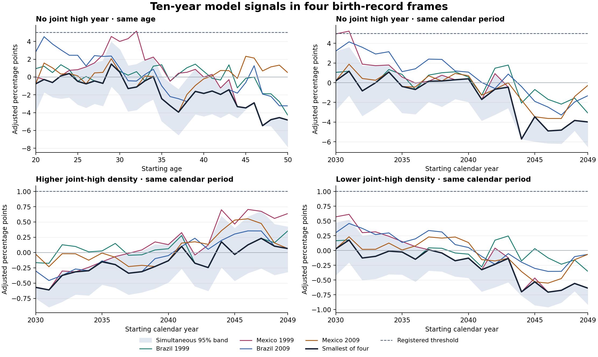

# R45 研究报告

**结论适用于巴西与墨西哥受检的 1999、2009 年出生登记框。** 按预登记的 R10 四体系联合高分规则，排除四组在同龄或同公历十年窗口共同多出 5 个百分点的无高分集中，也排除四组在同公历十年内联合高分密度共同上移或下移 1 个百分点。两个实际出生年分别作跨国同年检验，主分析的判定也一致。较小效应仍在区间内。[事前登记](REGISTRATION.zh.md) · [完整聚合表](results.json)

## 研究到底检验什么

单条出生记录在足岁 20–59 每年有四个结构分数，以巴西 2006 的同年龄段加权中秩确定分位。每一记录年有至少三体系达到第 80 百分位，记为一次「联合高分」。先对每条记录计算所有连续十年的有无高分及密度，再扣去该记录的窗口均值和固定参照在相应足岁起点的均值。[R10 原尺度](../r10/independent_replay/RESULTS.zh.md) · [R45 登记规则](REGISTRATION.zh.md)

「同龄」在 20–50 岁的十年起点中比较，同一个年龄会落在相隔约十年的公历时期。「同公历」只用四个框均有完整覆盖的 2030–2049 起点，每个窗口包含十年，末端最迟为 2058。共同效应取每个窗口四组效应中的最小值，再在预定起点中找最大值。以同一族同时区间覆盖扫描和两出生年配对。公历年份来自排盘时间格的索引，研究未使用其间现实事件。[计算口径与复现](REPRODUCE.md)

没有确认可独立归属的传闻原文、总体分母及跨流派的字面运段缺失规则。「大运排不出来一长段」的字面断言保留为未定。已实现的四套模型完整覆盖本次纳入的 20–59 岁评分格。各传统的起限和宫位争议，沿用版本化来源研究。[原始研究问题](../../docs/RESEARCH_QUESTIONS.md) · [紫微起限路径差异](../../R44.md)

## 数据、样本选择与压缩时钟

| 合格档案 | 分析记录 | 合格框 | 档案覆盖与选择 |
| --- | ---: | ---: | --- |
| 巴西 1999 | 2,000 | 49,348 | 约 99.54% 的合格框来自阿拉戈斯州，沿用 R15 已有分层样本 |
| 墨西哥 1999 | 766 | 766 | 仅覆盖 2022–2025 年晚登记的合格记录，合格框内全取 |
| 巴西 2009 | 2,000 | 2,751,932 | 从 2,881,581 条 SINASC 物理行筛出合格框，54 层独立抽样 |
| 墨西哥 2009 | 2,000 | 1,643,435 | 2009–2010 年登记档，严格重建 R10 排名，先排除 R10 的已选 2,000 行，再从余框抽取，52 层 |
| 巴西 2006 固定参照 | 2,000 | 沿用 R10 | 保持原始分数、权重、年龄段与中秩算法 |

巴西 2009 档案下载两次，字节一致。重新核对全档时得到相同的 2,751,932 条合格记录与 2,000 条入选记录。两国共 4,000 条新记录均逐条对回官方档案。巴西 2009 档中的主要排除项是无法用所定规则解析历史时区的 122,529 行。墨西哥新样本在 518 个发生地市镇匹配参考坐标，与 R10 样本的物理记录交集为零。墨西哥 2009 的 R10 原始抽样说明仍未找回，旧样本使用已核验的恢复文件。[出生档来源](SOURCE_SEALS.json) · [独立来源复核](source_review.json) · [R13](../../R13.md) · [R15](../../R15.md) · [R10 恢复记录](../r10/recovery/mexico2009/README.md)

## 主分析

效应、同时区间和门槛均以百分点计。起点是最强共同估计所在的十年窗口起点。负下界表示该量级范围也容许共同效应为零。区间固定抽样框、登记时刻和巴西 2006 参照，以逐记录向量的分层有限总体协方差及 9,999 次正态乘子确定 95% 同时界。[分组估计与置信带](results.json)

| 指标 | 范围 | 最强共同窗口起点 | 效应 | 95% 同时区间 | 预登记门槛 |
| --- | --- | ---: | ---: | ---: | ---: |
| 同龄无联合高分 | 四组 | 29 岁 | +1.45 | [−1.02, +3.93] | +5 |
| 同龄无联合高分 | 1999 两组 | 29 岁 | +1.45 | [−1.02, +3.93] | +5 |
| 同龄无联合高分 | 2009 两组 | 29 岁 | +2.06 | [−0.49, +4.60] | +5 |
| 同公历无联合高分 | 四组 | 2031 | +1.17 | [−1.26, +3.59] | +5 |
| 同公历无联合高分 | 1999 两组 | 2034 | +1.34 | [−0.81, +3.59] | +5 |
| 同公历无联合高分 | 2009 两组 | 2031 | +1.88 | [−0.89, +4.65] | +5 |
| 同公历联合高分密度上移 | 四组 | 2047 | +0.23 | [−0.24, +0.67] | +1 |
| 同公历联合高分密度上移 | 1999 两组 | 2049 | +0.35 | [−0.13, +0.67] | +1 |
| 同公历联合高分密度上移 | 2009 两组 | 2046 | +0.35 | [−0.03, +0.74] | +1 |
| 同公历联合高分密度下移 | 四组 | 2031 | +0.18 | [−0.20, +0.52] | +1 |
| 同公历联合高分密度下移 | 1999 两组 | 2031 | +0.18 | [−0.13, +0.52] | +1 |
| 同公历联合高分密度下移 | 2009 两组 | 2031 | +0.23 | [−0.14, +0.66] | +1 |

图中的粗线是在各窗口取四组最小估计所得的共同曲线。阴影是逐窗对四条带的下界、上界分别取最小值，横向虚线为预登记门槛。表中整个扫描指标的区间由这些带在相应起点集合内投影得到。

## 原始频率

在这套阈值下，无联合高分很常见。四组每条记录都找到至少一个连续十年窗口，其中约三分之一的记录在整个四十年评分期内没有联合高分。巴西 2006 参照也几乎人人具有连续十年窗口，33.20% 的记录整段没有联合高分。主检验量衡量这类窗口是否集中到同一段。[逐年龄率、逐公历窗口率及最长区段直方图](results.json)

| 出生档案 | 平均联合高分记录年 | 最长无高分段至少 10 年 | 最长无高分段至少 20 年 | 整个 40 年无高分 |
| --- | ---: | ---: | ---: | ---: |
| 巴西 2006 参照 | 3.21% | 99.95% | 91.60% | 33.20% |
| 巴西 1999 | 3.23% | 100.00% | 92.45% | 31.34% |
| 墨西哥 1999 | 3.13% | 100.00% | 93.60% | 36.68% |
| 巴西 2009 | 3.19% | 100.00% | 91.54% | 33.77% |
| 墨西哥 2009 | 3.23% | 100.00% | 90.86% | 33.65% |

## 对照结果

**出生分钟压缩。** 将同组记录的分钟改为原小时的 `:00`，重新计算了 5,288 条轨迹，另外 1,478 条原已在整点。四组均无压缩后时区偏移不明的时刻。按组有 31.20%–59.06% 的记录至少一年改变联合高分状态，变化的记录年占 1.42%–2.87%。四组共同同龄及同公历无高分上界降至 +3.00 与 +3.33 个百分点，均低于 +5。仅看 2009 年两组，同龄上界升至 +5.53，变为未分辨。[成对分钟压缩汇总](results.json)

**联合高分门槛。** 各体系的门槛放宽至第 75 百分位且重新校准固定参照，同龄无高分的四组共同上界升到 **+5.39** 个百分点。因此 +5 的同龄效应在这一判定口径下仍未分辨。同时，公历无高分的四组上界为 +4.37，公历联合高分上移、下移的上界分别为 +0.993 与 +0.789 个百分点。公历上移的上界接近 +1 门槛。只有按口径逐一作判断，才能保留这些精度差异。[第 75 百分位全量结果](results.json)

**共同历法与体系配对。** 499 次置换固定各体系整条四十年高分序列、原抽样层权重和出生历法分块，有效参与置换的加权占比为 94.26%–99.89%。按四组共同效应计算，原配对的最强同龄和同公历无高分峰值分别处于对照分布的内部。置换峰达到或超过原峰的比例分别为 27.8% 和 44.8%。公历高分密度上移、下移的相应比例为 37.8% 和 38.6%。因此这四个峰值与保留历法结构的重新配对相容。这个对照无法分解共享日期输入、出生选择与计算规则各自的贡献。[配对分块覆盖及完整对照表](results.json)

**样本选择。** 等人权重与仅取巴西 1999 阿拉戈斯的两种重算，四组同龄最大共同效应分别为 +1.46 和 +1.48 个百分点。四组都去掉整点记录后，最强同龄窗口的起点从 29 岁移到 21 岁，共同估计为 +1.76 个百分点。这些诊断的具体峰位会变动，按敏感性规则只报告点估计。[分组保留分母及比较](results.json)

**历史样本回看。** 原 R10 墨西哥 2009 样本在 29 岁和公历 2031 年的无高分效应分别为 +1.82 和 +0.85 个百分点。原 R13 墨西哥 1990–1998 另 4,642 条晚登记记录在 29 岁的合计效应为 +1.02。逐出生年为 −3.11 至 +4.17 个百分点。两项均按事先登记，只在主分析得到的指定峰值起点核对，回看范围限于原登记框。[回看数据与逐出生年分母](results.json)

## 校验与证据范围

平衡的合成阴性对照没有可分辨残差。将合成记录在 25–34 岁的高分置零时，同龄指标找回 25 岁起点，幅度 +22.18 个百分点，公历无高分的最强共同幅度为 +2.58。改在 2037–2046 公历时间置零时，公历无高分指标找回 2037 起点，幅度 +20.52，同龄最高为 +1.36。模拟用于检查能否区分两个时间索引。逐记录减去均值会使某段被压低后其他段相对上移，绝对频率需要另看原始率。[校验结果](results.json)

独立统计实现重建加权精确秩，并逐记录用整数掩码重新计数窗口。它核对三种分析的 420.77 万次阈值判定、各组曲线、最长缺段频率、条件误差及共同效应区间。每组另按事前散列抽 64 条重启同版本引擎，原时刻和适用的分钟压缩共 72,160 个分数逐个一致。两平台的聚合判定、窗口及分母一致。GitHub 保留登记、输入承诺和复算实现的历史提交。[复现方法](REPRODUCE.md) · [精确复算凭据](review.json) · [两平台核对](platform_replay.json)

两国各有两个可用的实际出生年。其中 1999 年的巴西合格记录地理集中，墨西哥样本又限于晚登记。因此总体外推、中国与东亚、其他出生年及十年以外的区段均超出本轮证据范围。真实死亡、就业或 AI 因果结局没有进入四体系分数或置信计算。真实死亡结局研究依宪章保持暂停。[研究宪章](../../CONSTITUTION.zh.md) · [来源覆盖](../../RESEARCH_STATUS.zh.md)
