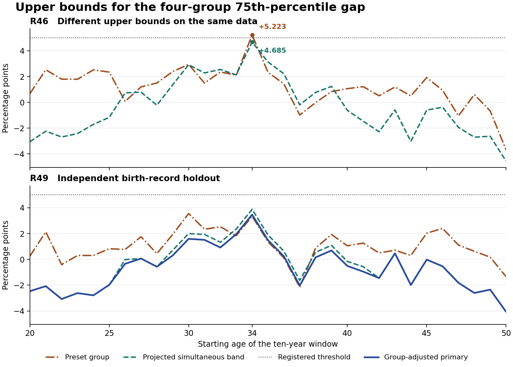

# R49 第 75 百分位同龄缺段的独立复验

问题是 1999、2009 年出生的巴西、墨西哥四组是否在同一年龄开始出现相对集中的十年缺段。十年内没有任何一年达到三体系联合高分才记为缺段。用第 75 百分位、原记录分钟、固定巴西 2006 年参照，依次扣除该记录各窗口均值与对应参照效应。四组共同峰是各年龄最小组效应的最大值，原关注量级为 **+5 个百分点**。[事前登记](REGISTRATION.zh.md)

## 新样本及原始资料

| 出生组 | 完整留出记录 | 合格来源余框 | 样本定义 |
| --- | ---: | ---: | --- |
| 巴西 1999 | 6,000 | 43,348 | 从 SINASC 原合格框排除 R15 与 R46 共 6,000 个物理键后抽样。合格来源集中于阿拉戈斯 |
| 墨西哥 1999 | 3,416 | 3,416 | INEGI 2013–2016 四档中的合格实际 1999 年出生记录，等权普查 |
| 巴西 2009 | 6,000 | 2,745,932 | 从 SINASC 原合格框排除 R45 与 R46 共 6,000 个物理键后抽样 |
| 墨西哥 2009 | 6,000 | 1,637,435 | 用 2009–2010 年官方档重建发生年 2009 的队列，验证 R10、R45、R46 的三个原排名段，排除其 8,000 个物理键后续抽 |

两组巴西与墨西哥 2009 按原发生州和登记性别分层，用本轮合格余框的精确权重。墨西哥 1999 的晚登记时期与 R46 不同。全部记录使用原档钟点与已说明的发生地近似。互斥按原档物理行验定，跨时期个人身份无法核对。[四组封存凭据](seals)

| 墨西哥登记年 | 实际 1999 年出生档案行 | 合格入组 |
| --- | ---: | ---: |
| 2011 | 3,039 | 0 |
| 2012 | 2,207 | 0 |
| 2013 | 1,884 | 926 |
| 2014 | 2,241 | 828 |
| 2015 | 1,994 | 774 |
| 2016 | 1,803 | 888 |

2011、2012 年档发布出生时分，实际发生地只到市镇，且缺沿用规则需要的发生地详细代码和地名目录。2014 年采用原档 `CATEMLN14` 地名表。2015 年字典的出生月 `Mes_nac` 在原 DBF 中名为 `MES_NACIM`，按字典作字段名归一，出生月份值及物理行号不变。[官方 2015 字段字典](https://www.inegi.org.mx/rnm/index.php/catalog/246/data-dictionary/F10) · [六份原档、字段及排除](seals/mx1999.json)

## R46 分歧与本轮方法

R46 主上界 +5.223 由 34 岁预选的巴西 2009 组给出。同时带在同一窗口取到墨西哥 2009 组的更低上界 +4.685。若仍用巴西组，同时带上界实际会扩大到 +6.040。分歧因此来自参加组间最小运算的证据与不同覆盖范围。R49 冻结新判定，对每个年龄的四组边际上界校正，再取共同峰的上界。同时复做旧定向界与全曲线同时带。[逐组诊断](R46_DIFFERENCE.zh.md) · [独立比较的预登记](REGISTRATION.zh.md)

## 结论

以 34 岁为起点的十年窗口给出四组共同峰 **+2.206 个百分点**。事前主上界 **+3.469**，低于 +5，故在这四个来源框内**排除达到原门槛的共同集中**。两项事前辅助比较给出同一门槛判断。各区间仍容许较小量级的共同集中。[聚合结果](results.json)

| 用于 R49 新样本的方法 | 下界 | 上界 | 对 +5 的判断 |
| --- | ---: | ---: | --- |
| 主检验，逐年龄校正四组上界 | +1.215 | +3.469 | **排除** |
| 辅助，按 R46 原来预选的组与临界值 | +1.072 | +3.552 | 排除 |
| 辅助，四组 × 31 个年龄的 95% 同时带 | +0.528 | +3.884 | 排除 |

表内单位为百分点。对 34–43 岁这一窗口，样本中最小组效应为巴西 2009 的 +2.206。该组标准误为 0.506，给出本轮主上界。按各组分别看，巴西 1999、墨西哥 1999 和墨西哥 2009 的同窗效应为 +3.325、+4.981 和 +2.645。上表回答的是四组共同峰，各组各自的效应和区间另列于聚合数据。

## 复核与范围

- 两次从原档重建的样本封存逐字节一致。独立读回 **21,416** 条新样本原档行，与 R10、R13、R15、R45、R46 的 **27,267** 个历史物理键比较无重叠。组间物理键也无重叠。复核直接从原 2015 DBF 读取 `MES_NACIM`。地理字典为两次共同的固定输入。[原档复核](source_review.json)
- 冻结 Linux 环境覆盖 **3,426,560** 项原分钟四体系年度分数。每组 64 条重启复算，共 **256** 条与原跑的 **40,960** 项分数逐项一致。独立统计程序以整数中秩、有理数均值及独立协方差方法核对 **3,746,560** 次阈值分类和 **9,999** 次乘子抽样，并重算 R46 的 31 个年龄上界与 R49 的三种判断。阴性对照回到零，注入对照恢复了 34 岁的共同缺段。[评分覆盖](results.json) · [独立统计复核](review.json)
- 首次聚合的权重有效样本量在 Linux 与 macOS 间最大末位差约为 \(9.1\times10^{-12}\) 条。复核后用分层权重的精确分数和计算该描述字段。逐平台对照修订前后，除该描述字段外，所有聚合数值及判断逐值一致。最终跨环境的 962 个浮点字段最大差为 \(2.22\times10^{-16}\)，所有离散字段相同。[修订凭据](platform_replay.json) · [复算步骤](REPRODUCE.md)

推断以指定合格来源框、记录钟点、地点近似、巴西固定参照及边际正态近似为条件。1999 年两组的地域和晚登记结构继续限制外推，跨档个人身份无法核对。现实事件及预测表现属于另行设计和授权的研究。本轮为项目内部计算复核，公开的是群组聚合、程序和证据收据。
