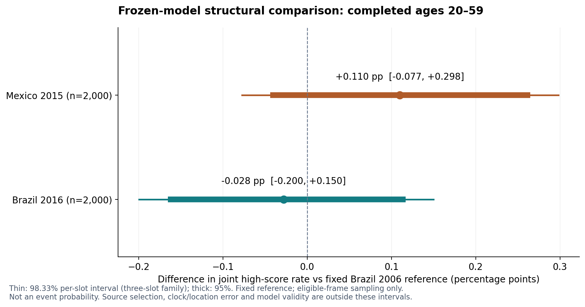
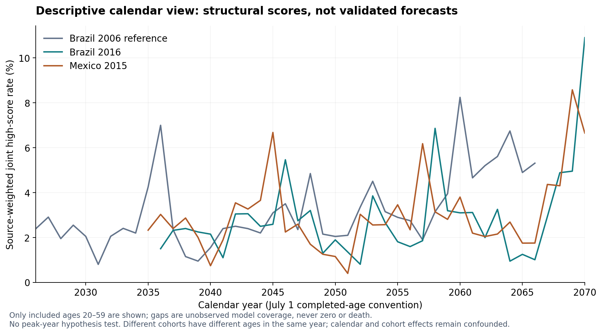

# R9 results: fixed-reference comparisons after expanding birth data

**27 November 2026, Asia/Shanghai. Two new cohorts completed; separate internal numerical implementation check passed.**

[中文完整报告](RESULTS.zh.md) · [Machine-readable results](results/structural_comparison.json) · [Data coverage](data/COVERAGE.md) · [Frozen protocol](protocol.json)

## Finding

Under the frozen four-model specification, the two restricted source samples show **no observed overall elevation of the prespecified magnitude in joint high-score rates**. Brazil 2016 is close to the fixed Brazil 2006 reference. Mexico 2015 is slightly higher, but both multiplicity-adjusted conditional sampling intervals include zero.

This finding does not validate astrology as a predictor of harm, establish AI safety, or estimate civilizational collapse or human replacement. No validated link from these scores to any such event exists in this study. Shared calendars and birth inputs also mean that agreement among the four calculations is not four independent pieces of real-world evidence. Independent mortality-outcome validation remains paused.

## Data actually added

| Frame | Source rows audited | Eligible source records | New sampled records |
|---|---:|---:|---:|
| Brazil SINASC 2016 | 2,857,800 | 2,736,944 | 2,000 |
| Mexico INEGI registration year 2015 | 2,353,596; 1,616,998 births dated 2015 | 1,254,336 | 2,000 |
| Earlier Brazil slot | Authentic 1996 and sole prespecified 2001 fallback archives acquired; headers inspected | Not constructed: birth-clock field absent | 0 |

All 4,000 new inputs produced complete four-system trajectories at 40 ages, adding 640,000 system-year scores. Including R8, the project contains **7,729 source-record projections and 1,236,640 system-year scores across five source frames**. These are not verified unique-person counts or 1.2 million individual samples. The country-label union remains **32**, because R8 already included Mexican records. Global representative sampling, Chinese 1990s/2000s population coverage and the unavailable older cohort remain unresolved. See the complete [coverage and exclusion ledger](data/COVERAGE.md).

## Estimand and primary results

R9 preserves the R8 Bazi, Ziwei, Qizheng and Western implementations. These are bounded executable models with disclosed gaps, not exhaustive implementations of every traditional school.

Instead of ranking each target record within its own trajectory, R9 fits a weighted mid-CDF to the frozen R8 Brazil 2006 reference, separately by system and ten-age band. Target records never refit that reference. A joint high-score year has at least three of four transformed values at or above 0.8. J is the source-weighted mean of each record's fraction of joint years over **completed ages 20–59**. It is not an adverse-event probability.

| Source sample | J | Difference from fixed reference | Adjusted conditional interval for difference |
|---|---:|---:|---:|
| Brazil 2006 reference, n=2,000 | 3.214943% | 0 | Reference held fixed |
| Brazil 2016, n=2,000 | 3.187123% | −0.027820 percentage points | [−0.199625, +0.149908] pp |
| Mexico 2015, n=2,000 | 3.324800% | +0.109857 percentage points | [−0.077447, +0.298245] pp |

Intervals use 1,999 whole-record stratified bootstrap draws with finite-population rescaling. Each interval has nominal marginal coverage 98.3333%, applying a three-slot Bonferroni family even though the earlier-Brazil slot is unavailable. They quantify sampling variation conditional on the fixed reference, frozen scores and restricted eligible frame. They exclude reference-estimation uncertainty, source selection, clock/location error, model validity and global generalization. Forty annual rows from one person are never treated as forty independent people.

Both intervals include zero and have upper bounds below the predeclared +1 pp structural resolution target. That target is not a danger threshold, and this is not a global equivalence or AI-safety conclusion. No p values for real-world AI, disaster or mortality hypotheses are produced.

Fixed-reference system means also do not move uniformly upward:

| System | Reference | Brazil 2016 | Mexico 2015 |
|---|---:|---:|---:|
| Bazi | 0.500000 | 0.501391 | 0.504279 |
| Ziwei | 0.500000 | 0.497575 | 0.495018 |
| Qizheng | 0.500000 | 0.501074 | 0.500537 |
| Western | 0.500000 | 0.491127 | 0.495131 |

These secondary quantities are descriptive, without added significance claims. The four-system mean differences, ΔL, are −0.002208 and −0.001259. Raw scores, age-band rates, annual denominators and the old R8 relative-rank continuity quantities are in the [JSON result](results/structural_comparison.json). The old and new definitions of J are different estimands, so their numerical difference is not a new cohort finding.

## Calendar view and interpretation

Only the descriptive calendar view is clipped to 2026–2070. The primary 40-age statistic can extend beyond 2070 for the new cohorts. Mexico 2015 first enters the selected age window in 2035, and Brazil 2016 in 2036. Earlier gaps denote absent coverage under this age rule, never zero scores, missing life, death or a civilizational discontinuity. No peak year was selected for a hypothesis test. Cohort, age and calendar effects remain entangled.

## Verification and public chronology

The [protocol commit](https://github.com/CPTM511/open-birth-chart-study/commit/bf15973ab70ff3cb24edfadd578ba67b5e53014d) preceded new cohort scoring. The [method/calibration commit](https://github.com/CPTM511/open-birth-chart-study/commit/9776383e1755129ea727f78532afa0802e296019) preceded inspection of new target distributions. The [separate verification implementation](https://github.com/CPTM511/open-birth-chart-study/commit/270ae36c99b400da26462c27bce932b53bd86560) was public before aggregation. These are auditable project freezes, not an external registration service's endorsement or peer review.

- Eight mathematical checks passed, including rational weighted-CDF comparisons and exhaustive enumeration of 27 ordered bootstrap samples.
- Two synthetic families each used 200 repetitions and three virtual slots. At least one adjusted interval missed its truth in 5.5% and 5.0% of repetitions. Every slot detected the artificial +1 pp injection in 200/200 repetitions. These are generator-specific results, not proof of 100% power or real predictive validity; see the [calibration report](methods/CALIBRATION_REPORT.md).
- A separate internal code path checked 118 aggregate quantities with zero mismatches; maximum absolute difference was 3.09e−14. Across 240 direct CDF checks, maximum difference was 5.70e−14. There were no threshold-classification disagreements. Input/profile hashes, complete age trajectories and all calendar entries were verified. This check did not replay bootstrap tail quantiles and is not external team replication. See [numerical review](verification/result_review.json).
- An independent implementation replayed the six existing R8 randomization tail counts, with all 30 comparisons agreeing. This verifies old arithmetic, not mortality outcomes; see [replay](methods/r8_tail_count_replay.json).
- All 130 existing R8 files remain byte-for-byte unchanged. No outcome labels entered the new scoring. The names `early_brazil` and `earlier_brazil` are a disclosed alias for one unavailable slot, not a fourth comparison.

## Material limitations

Mexico requires both birth and registration in 2015, excluding later registrations and heavily underrepresenting late-year births. The eligible frame contains 131,144 January births but only 20,423 December births. Five states were conservatively excluded. Coordinates are matched official 2020 locality reference points, not precise 2015 hospital locations. Brazil uses official 2022 municipal-seat reference points and excludes unresolved areas. Both frames exclude ambiguous or nonexistent DST clock labels. Minute resolution does not establish minute-level accuracy, and frame weights do not repair these exclusions.

Mexico's source reread is a separate pass sharing the DBF header parser and IANA runtime, not external replication. Exact reconstruction requires the recorded tzdb 2026c; scripts record but do not automatically install or enforce that version.

Traditional-rule conformance also remains incomplete: Bazi hierarchy and rescue adjudication, some Ziwei priorities, historical Qizheng Yuebo and degree-dependent periods, and a complete named Western doctrine. R9 does not silently revise those models after observing cohort effects. The [rule-conformance checklist](methods/RULE_CONFORMANCE_CHECKLIST.md) defines evidence required for later versions. Astronomical correctness, faithful traditional implementation and empirical prediction are separate questions.

## Separate AI evidence track

The project acquired 15 model estimates from [METR's 20 November 2026 update](https://metr.org/blog/2026-11-20-q4-2026-capability-update/) and actual [ILOSTAT occupational employment data](https://ilostat.ilo.org/data/bulk/). The public narrow labor subset has 5,211 rows and 121 reference areas, retaining 340 break flags, 24 unreliable flags and nine missing values. These are aggregate statistics, not personal samples or 121 necessarily independent national series.

METR's task horizon uses human expert completion time as its scale; it is neither continuous AI runtime nor a replacement countdown. We extracted provider estimates rather than refitting them. The labor table has no age field, coarse occupations and no merged AI-adoption measure, so no causal employment-replacement or young-cohort conclusion is made. Capabilities, employment effects and irreversible loss of control must be studied separately. See the [AI evidence ledger and methods](ai/README.md).

## Next useful iteration

Priorities are to obtain genuine-clock 1990s sources, account for later registration of the same Mexican birth cohort, independently test traditional-rule fixtures and clock/location sensitivity, and acquire age-by-occupation employment and actual AI-adoption data. Each changed model or sampling frame needs a new frozen version. Merely scaling the same selection and modeling assumptions to a million charts would not resolve representation or predictive validity.
