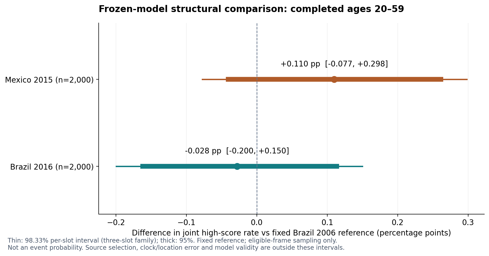
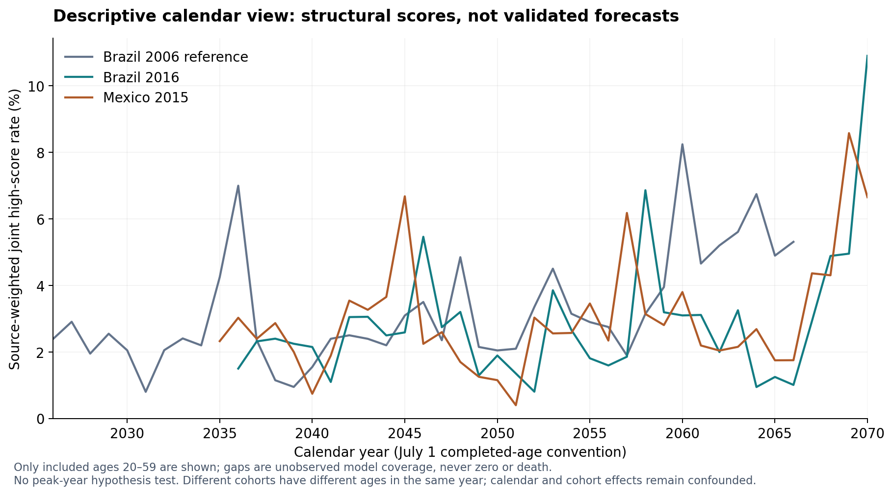

# R9研究结果：扩充出生数据后的固定参考比较

**日期：2026年11月27日（Asia/Shanghai）。状态：两组计算与内部独立代码路径复核完成。**

## 结论

在本轮冻结的四套计算模型、两组受限行政数据样本及固定参考定义下，**未观察到达到预设+1个百分点量级的整体联合高分抬升**。巴西2016组与参考组几乎相同；墨西哥2015组略高，但两组经过比较次数校正的条件抽样区间均包含0。

这项结果不能证明命理能够预测灾难，也不能证明AI不会取代人类或文明不会中断。我们没有建立“命盘指标→死亡或AI事件”的有效映射，更没有完成全球代表性抽样。四体系共享历法和出生输入，联合出现高分也不等于四份独立现实证据。独立死亡结局研究仍按要求暂停。

## 1. 实际扩充了什么

| 数据源 | 本轮实际审计范围 | 合格抽样框 | 新增样本 |
|---|---:|---:|---:|
| 巴西SINASC 2016 | 2,857,800条出生记录 | 2,736,944 | 2,000 |
| 墨西哥INEGI 2015登记档案 | 2,353,596条登记记录，其中1,616,998条出生于2015年 | 1,254,336 | 2,000 |
| 巴西1996及唯一预设备选2001 | 两份真实官方归档已取得，检查字段结构 | 缺少出生时刻字段，不建立四体系样本 | 0 |

新增4,000条记录均完成40个年龄点×4套模型，新增640,000个体系年度分数。连同R8，项目累计为**7,729条来源记录、1,236,640个体系年度分数、5个来源样本框**。这不是7,729个已跨库核实的独立个人，也不是123万个人样本。

国家标签仍为**32个**：R8的名人库已经包含墨西哥记录。本轮增加的是墨西哥行政来源和较晚出生队列；没有扩大国家标签数量，更没有补齐中国90后、00后的总体样本。完整排除账本、哈希、抽样权重及来源链接见[数据覆盖说明](data/COVERAGE.md)。

## 2. 检验的具体对象

R9继续使用R8的子平八字、紫微斗数、七政四余、西方占星计算实现，不改动评分规则。它们是四套有明确局限的可执行模型，不代表四种传统的所有流派或完整断事能力。

旧方法在每个人自己的40年轨迹中排序，可能漏掉整条轨迹同步上移。R9将R8巴西2006年的2,000条记录固定为参考：分别按体系及10岁年龄段建立加权中分布函数，所有新样本沿用同一参考，不在目标样本中重新定标。

某一年度至少3套模型达到参考分位0.8，记为一个“联合高分年度”。主指标J为每条记录20–59岁这40年中的联合高分占比，再按受限抽样框权重汇总。**J不是某人遭遇灾难、死亡或AI替代的概率。**

主统计包含完整20–59岁，因而2015/2016出生组会延伸到2070年之后。2026–2070只用于另行标注的描述性历年图。墨西哥、巴西新组最早分别于2035、2036年进入所设年龄窗口；此前的图中空缺表示未纳入该年龄窗口，不能解读为缺运、死亡或文明断层。

## 3. 主结果

| 样本 | 联合高分年度比例J | 相对固定参考差值 | 差值的校正条件区间 |
|---|---:|---:|---:|
| 巴西2006固定参考，n=2,000 | 3.214943% | 0 | 参考固定，不在本区间估计其误差 |
| 巴西2016，n=2,000 | 3.187123% | −0.027820个百分点 | [−0.199625, +0.149908]个百分点 |
| 墨西哥2015，n=2,000 | 3.324800% | +0.109857个百分点 | [−0.077447, +0.298245]个百分点 |

每个目标采用1,999次整条记录的分层自助抽样，并作有限总体修正；没有将同一人的40个年度当作40个独立人。区间为每槽98.3333%的近似区间，对预留的3个比较槽作Bonferroni校正，缺失的早期巴西槽仍保留。它们仅描述**固定参考、固定模型、受限合格抽样框下**的抽样不确定性，不含参考样本估计误差、来源选择偏差、时刻与坐标误差、模型有效性或全球外推误差。

两组区间均跨0，其上界也均低于事前设置的+1个百分点结构分辨目标。这支持限定条件下“未见该量级整体抬升”的表述；+1个百分点不是危险阈值，不能由此作全球等效性或AI安全结论。本轮没有生成现实灾难、AI事件或死亡假设的p值。

四套模型的固定参考均值也没有一致上移：

| 模型 | 巴西2006参考均值 | 巴西2016 | 墨西哥2015 |
|---|---:|---:|---:|
| 子平八字 | 0.500000 | 0.501391 | 0.504279 |
| 紫微斗数 | 0.500000 | 0.497575 | 0.495018 |
| 七政四余 | 0.500000 | 0.501074 | 0.500537 |
| 西方占星 | 0.500000 | 0.491127 | 0.495131 |

这些为固定参考分位均值，仅作描述。相应四体系均值差ΔL分别为−0.002208、−0.001259；没有为这些次要量另行挑选检验或显著性结论。原始分数、年龄段、旧R8相对排序指标及每年分母全部保存在[机器可读结果](results/structural_comparison.json)。R8的自身排序J与R9的固定参考J是不同指标，不能用两者差值制造新的发现。

历年曲线仅用于展示预先指定窗口，未挑选峰年做检验。不同队列在同一历年年龄不同，出生队列、年龄与历法效应尚未分离；日历周期造成的同步变化不具有AI因果含义。

## 4. 核验与公开顺序

研究方案在新队列评分前公开：[方案冻结提交](https://github.com/CPTM511/open-birth-chart-study/commit/bf15973ab70ff3cb24edfadd578ba67b5e53014d)。方法代码与模拟结果在查看新队列分布前公开：[方法封存提交](https://github.com/CPTM511/open-birth-chart-study/commit/9776383e1755129ea727f78532afa0802e296019)。另一套数值复核实现也在聚合前公开：[复核封存提交](https://github.com/CPTM511/open-birth-chart-study/commit/270ae36c99b400da26462c27bce932b53bd86560)。这是可审计的项目公开冻结，不等于外部注册平台认可或同行评审。

- 8项数学检查通过，含并列值、有理数直接计算及完整27种小样本自助抽样枚举。
- 两类合成场景各200次重复，三槽位区间至少一项漏覆盖真值的频率分别为5.5%与5.0%。人工注入+1个百分点时各槽均检出200/200；这仅适用于指定生成器，不是现实预测能力或100%功效证明。详见[校准报告](methods/CALIBRATION_REPORT.md)。
- 本轮内部另一套代码路径核对118项聚合数值，0不匹配，最大绝对差3.09×10⁻¹⁴；240个直接CDF检查点最大差5.70×10⁻¹⁴，0.8阈值无分类分歧。完整输入、输出哈希、40个年龄点及45个历年条目亦通过。该核验没有重复抽取自助抽样尾部分位数，也不是外部独立团队复现。见[数值核验](verification/result_review.json)。
- 另用独立实现复算R8六项检验的随机模拟尾计数，30项比较一致；这是旧结果的数值复核，不是新死亡验证。见[R8尾计数复算](methods/r8_tail_count_replay.json)。
- R8原有130个文件逐一保持原始字节；新模型计算没有读取死亡结局。早期巴西槽在方案和适配器中分别名为`early_brazil`与`earlier_brazil`，仅为同一缺失槽的标识别名，比较家族仍为3。

## 5. 必须保留的数据与模型边界

**墨西哥存在同年登记截断。** 本次只纳入2015年出生且2015年登记者，较晚登记未纳入；合格框中1月出生131,144条，12月仅20,423条。不能将这种出生月份分布解释为全民出生分布。另保守排除5州，使用2020年官方地点参考点而非2015年医院坐标。

**巴西也有地理与时间筛选。** 出生坐标是2022年官方市镇驻地参考，部分跨时区地区没有可确认的映射。两国均排除无法唯一解释的夏令时跳时、重叠时刻；钟点精确到分钟不代表实际误差只有一分钟。权重只能还原已定义的合格框，不能纠正这些选择。墨西哥源文件复读共用DBF头解析器及IANA运行时；精确重建须按记录使用tzdb2026c，脚本记录但不自动强制安装版本。

**传统符合度尚未补齐。** 八字的格局、旺衰和救应判定，紫微的部分组合优先级，七政历史月孛算法与度数行限，以及西方占星完整传统判定仍有缺口。R9为保持可比性未更改这些规则。后续证据和例题要求见[传统规则符合度清单](methods/RULE_CONFORMANCE_CHECKLIST.md)。天文位置算对、传统实现一致、现实预测有效，是三个不同问题。

## 6. AI现实指标线

另行下载并整理了[METR 2026年11月20日研究](https://metr.org/blog/2026-11-20-q4-2026-capability-update/)的15个模型估计及[ILOSTAT职业就业数据](https://ilostat.ilo.org/data/bulk/)。公开劳动子集为5,211行、121个参考地区，保留340行断序标记、24行不可靠标记和9行数值缺失。

METR的能力时长指标使用人类专家完成任务的时长作为尺度，不是AI连续运行时长，更不是人类被替代的倒计时。我们提取原机构结果，未独立重拟合。就业表没有年龄字段、职业粒度较粗，尚未合并AI采用强度，因此没有得出90后、00后就业替代的因果结论。能力进展、就业变化和不可恢复的失控必须分别研究。方法、原始出处和审计见[AI研究线](ai/README.zh.md)。

## 7. 下一轮最值得做的事

1. 补齐出生队列和登记延迟：优先寻找有真实时刻的1990年代来源，并将墨西哥后续登记年份中同一出生年的记录纳入新的、事先冻结的抽样框。
2. 核验传统规则和时地敏感性：先建立有来源的判例、边界和反例，再版本化更改模型；不因某套规则产生更惊人的结果而选用它。
3. 推进AI现实检验：寻找年龄×职业细分就业数据及实际AI采用强度，处理口径断点，再设计可检验的比较。

单纯把同样的偏差放大到百万命盘，不能解决代表性、规则有效性或现实预测效度。本轮提供了更大的可追溯数据基础和明确的结构结果；尚无依据把这些命盘分数解释为人类文明将中断或不会中断的证据。
